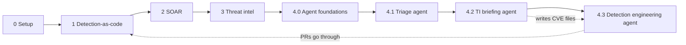
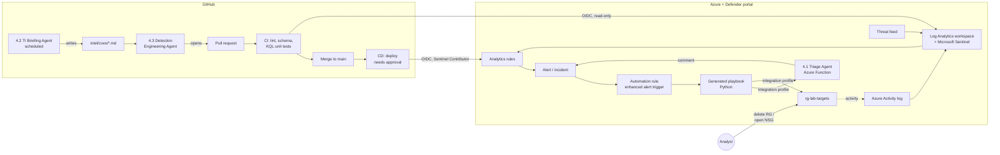
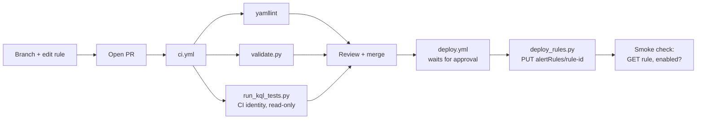
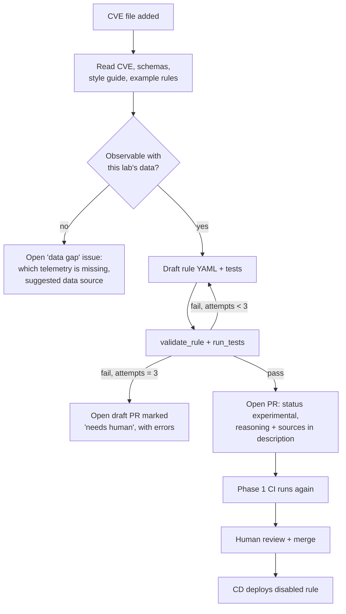

# Sentinel Detection-as-Code Lab

A hands-on, end-to-end security operations lab on Microsoft Sentinel and the Microsoft Defender portal. Anyone with an Azure subscription and a GitHub account can follow it step by step.

You will:

1. Write detection rules as YAML with KQL inside, test them in GitHub Actions, and deploy them to Sentinel through a CI/CD pipeline.
2. Make a real change in your Azure subscription that triggers a rule, and follow it from log event → alert → incident.
3. Have a Sentinel SOAR playbook, built with the Defender portal's playbook generator, respond to the alert automatically.
4. Ingest a threat feed and match it against your activity.
5. Build your own AI agents from scratch, modelled on the agents Microsoft ships for its security products: an incident triage agent, a threat-intel briefing agent, and a detection engineering agent that turns a CVE file in the repo into a tested detection-rule pull request.

The lab shows, with working code and evidence, the skills a detection engineering or SOC automation role needs:

- **Detection-as-code**: rules live in Git, change through pull requests, and are tested before they reach Sentinel.
- **Secure CI/CD**: GitHub Actions authenticates to Azure with OIDC (no stored secrets), and production deploys need a human approval.
- **Alert → incident → response**: real Azure activity fires the rule, and an automation rule runs a playbook without a human starting it.
- **Agents with guardrails**: agents read, reason and propose; humans approve anything that changes production.
- **Small and finished beats big and half-done**: each phase works end to end before the next one starts.

**Status:** Phase 0 (setup). Planned with [OpenSpec](https://github.com/Fission-AI/openspec) (see [section 12](#12-spec-driven-workflow-with-openspec)).

> **Lab only.** Use a personal Azure subscription and tenant dedicated to this lab, never an employer or production tenant. Anything that can change resources is scoped to one lab resource group.

---

## Contents

1. [Learning outcomes](#1-learning-outcomes)
2. [Scope and roadmap](#2-scope-and-roadmap)
3. [Prerequisites](#3-prerequisites)
4. [Architecture](#4-architecture)
5. [Conventions](#5-conventions)
6. [Phase 0: Setup](#6-phase-0-setup)
7. [Phase 1: Detection-as-code](#7-phase-1-detection-as-code)
8. [Phase 2: SOAR with the Sentinel playbook generator](#8-phase-2-soar-with-the-sentinel-playbook-generator)
9. [Phase 3: Threat intel matching](#9-phase-3-threat-intel-matching)
10. [Phase 4: Build your own security agents](#10-phase-4-build-your-own-security-agents)
11. [Stretch goals](#11-stretch-goals)
12. [Spec-driven workflow with OpenSpec](#12-spec-driven-workflow-with-openspec)
13. [Troubleshooting](#13-troubleshooting)
14. [Costs, safety and teardown](#14-costs-safety-and-teardown)
15. [Project checklist](#15-project-checklist)

---

## 1. Learning outcomes

| Area | By the end you can |
|---|---|
| **Microsoft Sentinel** | Connect a data source, write and tune scheduled analytics rules, work incidents, use automation rules and workbooks |
| **Microsoft Defender portal** | Run Sentinel from the Defender portal: incidents, automation rules, playbooks, integration profiles, and how Defender alerts and Sentinel incidents fit together |
| **Detection rules** | Write KQL detections with full metadata (MITRE ATT&CK, severity, entity mappings) and unit-test them |
| **Alert → incident** | Trigger a rule on purpose, trace it from raw log to alert to incident, and explain each step and its delay |
| **SOAR** | Build a Python playbook with the Sentinel playbook generator that enriches, comments and remediates automatically, with least-privilege integrations |
| **AI agents** | Build an agent from scratch (one LLM call → tools → loop → memory → evals) and put it into a real security workflow |
| **Secure SDLC** | OIDC, protected environments, branch protection, CodeQL, Dependabot, secret scanning |
| **Spec-driven development** | Plan each piece of work as an OpenSpec change: proposal → spec → tasks → build → archive |

---

## 2. Scope and roadmap

### Roadmap

| Phase | Outcome | Rough effort* |
|---|---|---|
| **0. Setup** | Activity logs flow into Sentinel in the Defender portal; GitHub deploys to Azure with OIDC | 1 week |
| **1. Detection-as-code** | Rule 1 (resource group deleted) is tested in CI, deployed by CD, and fires on a real deletion | 2 weeks |
| **2. SOAR** | Rule 2 (NSG opened to the internet) fires, and a generated playbook comments, tags and removes the bad NSG rule | 2 weeks |
| **3. Threat intel** | One free feed is ingested; Rule 3 matches indicators against Azure activity | 1–2 weeks |
| **4.0 Agent foundations** | A minimal agent loop written by hand, with tools, limits, logging and tests | 1 week |
| **4.1 Incident Triage Agent** | Classifies lab incidents, explains its verdict, learns from analyst feedback | 2 weeks |
| **4.2 Threat Intel Briefing Agent** | Weekly briefing of new exploited CVEs and feed activity relevant to *your* environment | 1–2 weeks |
| **4.3 Detection Engineering Agent** | A CVE file in the repo becomes a pull request with a rule and tests, or a "data gap" issue | 3 weeks |

\*At about 6–8 hours a week. Each phase must work end to end, with evidence (screenshots, run links, incident IDs), before the next one starts.



### Out of scope (for now)

- Virtual machines, endpoint telemetry, Atomic Red Team. Every rule here uses the Azure Activity log, which is free to ingest into Sentinel and needs no VM.
- Sigma and rule conversion. Rules are native Sentinel YAML + KQL.
- Agents that take actions on their own. All agents here are read-only or propose changes through pull requests.
- Multi-agent orchestration frameworks. Agents are plain Python first (see [stretch goals](#11-stretch-goals)).

An earlier, larger design (CVE → multi-agent pipeline → Sigma → Sentinel) is parked in [project_ideas/01-cve-to-rule](project_ideas/01-cve-to-rule/README.md). Phase 4.3 brings back its core idea in a smaller form.

---

## 3. Prerequisites

### Accounts

| Need | Notes |
|---|---|
| Azure subscription | Pay-as-you-go or a free trial, with **Owner** rights. Dedicated to this lab |
| Microsoft Entra ID | The free tier that comes with the subscription is enough. You need rights to create app registrations and grant admin consent |
| Microsoft Defender portal access | security.microsoft.com, with the Sentinel workspace connected. Defender unified RBAC permission **Automation Playbooks (Read and Write)** for Phase 2 |
| GitHub account | A repository for this project (public or private) |
| LLM API key (Phase 4) | Any provider with tool calling. Examples use Claude (e.g. `claude-sonnet-5-5`); set a monthly spend limit |
| Optional enrichment keys (Phase 4) | VirusTotal and/or AbuseIPDB free tier |

### Local tools

| Tool | Version | Used for |
|---|---|---|
| Azure CLI (`az`) | latest | Setup, OIDC, testing |
| Python | 3.11+ | Validation, tests, deploy scripts, agents |
| Git + GitHub CLI (`gh`) | latest | Repo, PRs, environments |
| Node.js | 20.19+ | OpenSpec CLI |
| VS Code + extensions | - | Bicep, YAML, Kusto, Python |

### Knowledge assumed

Basic Azure portal navigation, Git branching and pull requests, and beginner Python. KQL is learned along the way; the [Must Learn KQL](https://github.com/rod-trent/MustLearnKQL) series is a good companion.

---

## 4. Architecture



### Design principles

- **Everything that can be code is code.** Rules, infrastructure and agent code live in Git and are deployed by the pipeline. Generated playbooks are authored in the Defender portal; their Python code and documentation are copied into the repo for review and history (see [8.6](#86-keep-the-playbook-in-git)).
- **No stored secrets where avoidable.** GitHub uses OIDC; Azure Functions use managed identities; API keys live in Key Vault. The one exception is the client secret an integration profile needs, which is short-lived and scoped narrowly.
- **Least privilege.** Each identity gets only the role it needs at the narrowest scope.
- **Humans approve risky steps.** Production deploys use a protected environment; agents propose, humans merge.
- **Test against reality.** Synthetic test data is checked against real events from your own workspace.
- **Untrusted input stays untrusted.** Incident fields, resource names, threat reports and CVE text can contain attacker-controlled strings. Agents treat them as data, never as instructions.

### Repository layout (target)

```
.github/workflows/
  ci.yml                     # on PR: lint, schema check, KQL unit tests, agent evals
  deploy.yml                 # on merge to main: deploy analytics rules
  ti-ingest.yml              # Phase 3: scheduled feed upload
  ti-briefing.yml            # Phase 4.2: scheduled briefing agent
  detection-agent.yml        # Phase 4.3: runs when intel/cves/ changes
config/
  lab.env.example            # names and IDs used across scripts (no secrets)
detections/
  azure_activity/
    rg_deletion.yaml
    nsg_open_to_internet.yaml
    ti_ip_match.yaml
tests/
  detections/                # one *.test.yaml per rule
schemas/
  AzureActivity.yaml         # columns available in this lab (the "data contract")
  ThreatIntelIndicators.yaml
playbooks/
  nsg-remediate/
    prompt.md                # the natural-language spec given to the generator
    playbook.py              # copy of the generated code, reviewed in a PR
    README.md                # generated documentation + flow diagram
    automation-rule.md       # trigger conditions as configured in the portal
  ti-match-enrich/
  triage-agent-call/
workbooks/
infra/                       # Bicep: diagnostic settings, roles, Key Vault, Function App
scripts/
  validate.py                # schema + metadata checks
  run_kql_tests.py           # runs rule KQL against test data in the workspace
  deploy_rules.py            # YAML -> Sentinel REST API (idempotent PUT)
  ti_upload.py               # Phase 3
agents/
  core/                      # 4.0: LLM client, tool registry, loop, logging
  triage/                    # 4.1
  ti_briefing/               # 4.2
  detection_engineer/        # 4.3
  evals/                     # golden sets + eval runner
intel/
  cves/                      # CVE input files for 4.3
  inventory.yaml             # technologies in your environment, for 4.2
briefings/                   # 4.2 output
docs/
  detection-style.md         # how rules in this repo are written (also used by 4.3)
  evidence/                  # screenshots and run links per phase
openspec/                    # specs and changes (section 12)
notes/                       # learning notes
project_ideas/               # parked ideas
```

---

## 5. Conventions

Placeholders used throughout. Copy `config/lab.env.example` to `config/lab.env` (git-ignored) and fill it in.

| Placeholder | Example | Meaning |
|---|---|---|
| `<SUBSCRIPTION_ID>` | `00000000-...` | Lab subscription |
| `<TENANT_ID>` | `00000000-...` | Entra tenant |
| `<LOCATION>` | `australiaeast` | Azure region |
| `<RG_SENTINEL>` | `rg-sentinel-lab` | Workspace and Function App |
| `<RG_TARGETS>` | `rg-lab-targets` | Things you break on purpose |
| `<WORKSPACE>` | `law-sentinel-lab` | Log Analytics workspace name |
| `<WORKSPACE_ID>` | `00000000-...` | Workspace *customer ID* (used for queries) |
| `<GH_REPO>` | `your-user/sentinel-dac-lab` | GitHub `owner/repo` |

Other conventions:

- Rule IDs are fixed GUIDs, generated once (`python -c "import uuid; print(uuid.uuid4())"`) and never reused.
- Rule `status` lifecycle: `experimental` (deploys disabled) → `test` (enabled) → `stable`.
- Branch names: `feat/<change-name>`, matching the OpenSpec change name.
- Each phase ends with a short write-up in `notes/` and evidence in `docs/evidence/phase-N/`.

---

## 6. Phase 0: Setup

**Goal:** Azure activity reaches Sentinel, Sentinel is used from the Defender portal, and GitHub can talk to Azure safely.

### Steps

**0.1 Sign in and create resource groups**

```bash
az login
az account set --subscription <SUBSCRIPTION_ID>
az group create -n <RG_SENTINEL> -l <LOCATION>
az group create -n <RG_TARGETS>  -l <LOCATION>
```

Keep the workspace in its own resource group so it is never deleted by accident during testing.

**0.2 Workspace and Sentinel** (skip if you already have a Sentinel workspace)

```bash
az monitor log-analytics workspace create -g <RG_SENTINEL> -n <WORKSPACE> -l <LOCATION>
az extension add --name sentinel
az sentinel onboarding-state create -g <RG_SENTINEL> --workspace-name <WORKSPACE> --name default
```

Or add Microsoft Sentinel to the workspace in the Azure portal.

**0.3 Connect the workspace to the Defender portal**

In security.microsoft.com, connect the Sentinel workspace (the portal prompts you on first visit, or use the Sentinel workspace settings) and make it the primary workspace. Do all daily work there from now on; the playbook generator in Phase 2 is only available in the Defender portal. Check that **Microsoft Sentinel → Configuration → Automation** is visible.

**0.4 Send the subscription Activity log to the workspace**

Either install the *Azure Activity* solution from Sentinel Content hub and follow its connector page (it creates the diagnostic setting through Azure Policy), or create the diagnostic setting directly:

```bash
WS_RESOURCE_ID=$(az monitor log-analytics workspace show -g <RG_SENTINEL> -n <WORKSPACE> --query id -o tsv)
az monitor diagnostic-settings subscription create \
  --name activity-to-sentinel --location <LOCATION> \
  --workspace "$WS_RESOURCE_ID" \
  --logs '[{"category":"Administrative","enabled":true},{"category":"Security","enabled":true},{"category":"Policy","enabled":true},{"category":"Alert","enabled":true}]'
```

Install the Azure Activity solution anyway; it brings rule templates and a workbook worth reading.

Check (data can take 10–15 minutes to appear the first time):

```kql
AzureActivity
| where TimeGenerated > ago(1h)
| summarize count() by OperationNameValue, ActivityStatusValue
| top 20 by count_
```

**0.5 Budget**

In Cost Management, create a subscription budget with an email alert at a low amount (for example 10 in your currency) at 50%, 80% and 100%.

**0.6 GitHub repository hygiene**

- Branch protection on `main`: pull request required, CI must pass, no direct pushes.
- Environment `production` with yourself as **required reviewer**.
- Turn on Dependabot alerts and updates, CodeQL code scanning (Python), and secret scanning with **push protection**.

**0.7 GitHub → Azure with OIDC**

Create two identities so pull-request code can never deploy:

```bash
# CI identity: read-only, used on pull requests
CI_APP=$(az ad app create --display-name gh-sentinel-ci --query appId -o tsv)
az ad sp create --id $CI_APP
az ad app federated-credential create --id $CI_APP --parameters '{
  "name": "gh-pr", "issuer": "https://token.actions.githubusercontent.com",
  "subject": "repo:<GH_REPO>:pull_request", "audiences": ["api://AzureADTokenExchange"]}'
az role assignment create --assignee $CI_APP --role "Log Analytics Reader" --scope "$WS_RESOURCE_ID"

# Deploy identity: only usable from the protected production environment
CD_APP=$(az ad app create --display-name gh-sentinel-deploy --query appId -o tsv)
az ad sp create --id $CD_APP
az ad app federated-credential create --id $CD_APP --parameters '{
  "name": "gh-prod", "issuer": "https://token.actions.githubusercontent.com",
  "subject": "repo:<GH_REPO>:environment:production", "audiences": ["api://AzureADTokenExchange"]}'
RG_ID=$(az group show -n <RG_SENTINEL> --query id -o tsv)
az role assignment create --assignee $CD_APP --role "Microsoft Sentinel Contributor" --scope "$RG_ID"
```

| Identity | Role | Scope | Used by |
|---|---|---|---|
| `gh-sentinel-ci` | Log Analytics Reader | Workspace | KQL unit tests on PRs |
| `gh-sentinel-deploy` | Microsoft Sentinel Contributor | `<RG_SENTINEL>` | Deploying analytics rules |

Store **IDs only** as GitHub variables or secrets: `AZURE_TENANT_ID`, `AZURE_SUBSCRIPTION_ID`, `AZURE_CI_CLIENT_ID`, `AZURE_CD_CLIENT_ID`, `WORKSPACE_ID`. No client secrets in GitHub.

**0.8 Smoke-test workflow**

```yaml
# .github/workflows/oidc-smoke.yml
name: oidc-smoke
on: workflow_dispatch
permissions:
  id-token: write
  contents: read
jobs:
  whoami:
    runs-on: ubuntu-latest
    environment: production
    steps:
      - uses: azure/login@v2
        with:
          client-id: ${{ secrets.AZURE_CD_CLIENT_ID }}
          tenant-id: ${{ secrets.AZURE_TENANT_ID }}
          subscription-id: ${{ secrets.AZURE_SUBSCRIPTION_ID }}
      - run: az account show --query "{sub:id, user:user.name}"
```

### Done when

- [ ] The KQL check in 0.4 returns rows, both in the Azure portal and in the Defender portal (Advanced hunting).
- [ ] `oidc-smoke` succeeds after you approve it in the `production` environment.
- [ ] Budget alert, branch protection, push protection and CodeQL are on.

### Learning checkpoint

- What is the difference between the workspace resource ID and the workspace (customer) ID, and which one does each tool need?
- Why does the federated credential `subject` matter, and what stops a pull request from using the deploy identity?
- What changes when Sentinel is used from the Defender portal instead of the Azure portal?

---

## 7. Phase 1: Detection-as-code

**Goal:** one rule goes through the full lifecycle: write → test → PR → CI → approve → deploy → trigger → incident.

### 7.1 Rule format

Rules use the YAML layout of the [Azure-Sentinel GitHub repo](https://github.com/Azure/Azure-Sentinel/tree/master/Detections), so they are familiar to anyone who works with Sentinel. The KQL lives inside the YAML with all the metadata.

Why YAML rather than ARM JSON: it is easy to read and review in a pull request, the query is not escaped inside a JSON string, and it matches the community format. `deploy_rules.py` converts it to the Sentinel REST API body at deploy time. (Sentinel's built-in *Repositories* feature accepts only ARM/Bicep, which is why this lab has its own pipeline.)

Write the conventions down in `docs/detection-style.md`: required fields, naming, how `queryPeriod` and `ingestion_time()` are used, entity mapping rules. The Phase 4.3 agent will read this file too.

### 7.2 Rule 1: Resource group deleted

`detections/azure_activity/rg_deletion.yaml`

```yaml
id: 3f6c1a52-8e0b-4b8e-9a1d-6f2a9c4d7e10   # fixed GUID; also the rule's resource name in Sentinel
name: Azure resource group deleted
description: |
  A resource group was deleted. Deleting a resource group removes every resource in it,
  so it can be destructive activity by an attacker (T1485) or a costly mistake.
severity: Medium
status: test                     # experimental -> test -> stable
kind: Scheduled
requiredDataConnectors:
  - connectorId: AzureActivity
    dataTypes:
      - AzureActivity
queryFrequency: 5m
queryPeriod: 30m
triggerOperator: gt
triggerThreshold: 0
tactics:
  - Impact
relevantTechniques:
  - T1485
query: |
  // queryPeriod is longer than queryFrequency so late-arriving Activity log events are not missed;
  // the ingestion_time() filter stops the same event alerting on more than one run.
  AzureActivity
  | where ingestion_time() > ago(5m)
  | where OperationNameValue =~ "MICROSOFT.RESOURCES/SUBSCRIPTIONS/RESOURCEGROUPS/DELETE"
  | where ActivityStatusValue in~ ("Success", "Succeeded")
  | summarize arg_min(TimeGenerated, *) by CorrelationId
  | project TimeGenerated, Caller, CallerIpAddress, SubscriptionId, ResourceGroup, CorrelationId, _ResourceId
entityMappings:
  - entityType: Account
    fieldMappings:
      - identifier: FullName
        columnName: Caller
  - entityType: IP
    fieldMappings:
      - identifier: Address
        columnName: CallerIpAddress
  - entityType: AzureResource
    fieldMappings:
      - identifier: ResourceId
        columnName: _ResourceId
incidentConfiguration:
  createIncident: true
version: 1.0.0
```

### 7.3 Rule tests

Each rule has a test file with sample rows and the number of results expected. `run_kql_tests.py`:

1. Builds a `datatable` from the rows, using column types from `schemas/AzureActivity.yaml`.
2. Prepends `let AzureActivity = datatable(...)[...];` so the rule's query reads the test rows instead of the real table.
3. Replaces `ingestion_time()` with `TimeGenerated` (a datatable has no ingestion time).
4. Runs the query against the workspace (`az monitor log-analytics query -w <WORKSPACE_ID> ...` or the `azure-monitor-query` Python SDK).
5. Compares the row count with `expect_rows` and fails CI on any mismatch.

`tests/detections/rg_deletion.test.yaml`

```yaml
rule: detections/azure_activity/rg_deletion.yaml
cases:
  - name: successful RG delete alerts once even with Start + Success events
    expect_rows: 1
    rows:
      - { OperationNameValue: MICROSOFT.RESOURCES/SUBSCRIPTIONS/RESOURCEGROUPS/DELETE, ActivityStatusValue: Start,   CorrelationId: c1, Caller: analyst@lab.example }
      - { OperationNameValue: MICROSOFT.RESOURCES/SUBSCRIPTIONS/RESOURCEGROUPS/DELETE, ActivityStatusValue: Success, CorrelationId: c1, Caller: analyst@lab.example }
  - name: failed delete does not alert
    expect_rows: 0
    rows:
      - { OperationNameValue: MICROSOFT.RESOURCES/SUBSCRIPTIONS/RESOURCEGROUPS/DELETE, ActivityStatusValue: Failure, CorrelationId: c2 }
  - name: RG write does not alert
    expect_rows: 0
    rows:
      - { OperationNameValue: MICROSOFT.RESOURCES/SUBSCRIPTIONS/RESOURCEGROUPS/WRITE, ActivityStatusValue: Success, CorrelationId: c3 }
```

**Ground the tests in reality:** before trusting synthetic rows, delete a test resource group once, export the real events (`AzureActivity | where CorrelationId == "<id>"`), and confirm the field names and status values match. Save a sanitised copy under `tests/fixtures/real/`.

### 7.4 Validation rules (`validate.py`)

| Check | Why |
|---|---|
| Required fields present (`id`, `name`, `severity`, `query`, `queryFrequency`, `queryPeriod`, `tactics`, `relevantTechniques`, `entityMappings`, `version`) | Sentinel rejects or misbehaves without them |
| `id` is a GUID and unique across the repo | It is the resource name; duplicates overwrite each other |
| Tactics and technique IDs are valid ATT&CK values | Bad metadata breaks coverage reporting |
| `queryPeriod >= queryFrequency` | Otherwise events fall between runs |
| Every entity-mapping column appears in the query's `project` | Otherwise entities are silently empty |
| Every rule has a test file with at least one positive and one negative case | No untested rules |
| `version` increases when `query` changes | Change tracking |

### 7.5 Deployment (`deploy_rules.py`)

For each changed YAML file, convert it to the REST body and `PUT`:

```
PUT https://management.azure.com/subscriptions/<SUBSCRIPTION_ID>/resourceGroups/<RG_SENTINEL>
    /providers/Microsoft.OperationalInsights/workspaces/<WORKSPACE>
    /providers/Microsoft.SecurityInsights/alertRules/<rule id>?api-version=<latest stable>
```

| YAML field | REST `properties` field | Conversion |
|---|---|---|
| `name` | `displayName` | as is |
| `queryFrequency: 5m` | `queryFrequency` | ISO 8601: `PT5M` |
| `queryPeriod: 30m` | `queryPeriod` | `PT30M` |
| `triggerOperator: gt` | `triggerOperator` | `GreaterThan` |
| `relevantTechniques` | `techniques` / `subTechniques` | split `T1562.007` into both |
| `status` | `enabled` | `false` when `experimental` |
| `entityMappings`, `incidentConfiguration` | same names | as is |

Because the YAML `id` is the resource name, the `PUT` is idempotent: running it twice changes nothing. Deleting a YAML file deletes the rule, but only for rules the pipeline created (keep a manifest of deployed IDs, or tag the description with `[source: repo]`).

### 7.6 Pipeline



- **`ci.yml`** runs on `pull_request`, logs in with the CI identity, and runs the three checks.
- **`deploy.yml`** runs on push to `main`, uses `environment: production` (so it waits for approval), logs in with the deploy identity, deploys only changed files, then reads each rule back to confirm it exists and is enabled.

### 7.7 Trigger it

1. `az group create -n rg-lab-delete-me-01 -l <LOCATION>`
2. `az group delete -n rg-lab-delete-me-01 --yes`
3. Wait. Activity log events usually arrive within a few minutes, and the rule runs every 5 minutes, so expect roughly 5–20 minutes.
4. Open the incident in the Defender portal. Check the entities: account, IP, resource.
5. Write down the time of each step: delete → event `TimeGenerated` → `ingestion_time()` → alert → incident.

### Done when

- [ ] A PR that changes the rule passes CI, is merged, and is deployed after approval.
- [ ] A real deletion creates exactly one incident with correct entities.
- [ ] Evidence saved: PR link, workflow run links, incident screenshot, timing table.

### Learning checkpoint

- Why `ingestion_time()` and not just `TimeGenerated` for the 5-minute window?
- What happens if the rule's lookback equals its frequency and an event arrives 8 minutes late?
- Which fields would you allowlist to stop alerts from your own automation (for example, a CI pipeline that deletes temporary resource groups)?

---

## 8. Phase 2: SOAR with the Sentinel playbook generator

**Goal:** a second rule whose alert starts a playbook automatically, with no human in between.

### 8.1 About the playbook generator

The Defender portal has a **SOAR playbook generator** (Microsoft Sentinel → Configuration → Automation → Playbooks → Create → *Playbook Generator*). You describe the playbook in natural language to an AI coding agent in a VS Code editor embedded in the portal. It writes a plan, then Python code, documentation and a flow diagram, and can test the playbook against a real alert. Key points, from [Microsoft's documentation](https://learn.microsoft.com/en-us/azure/sentinel/automation/generate-playbook) at the time of writing:

| Topic | What it means for this lab |
|---|---|
| **Requirements** | Workspace connected to the Defender portal; Defender RBAC *Automation Playbooks (Read and Write)*; *Microsoft Sentinel Contributor* to create automation rules. No separate Security Copilot licence needed. Permissions can take up to two hours to apply |
| **Input** | **Alerts only.** The playbook receives the alert (with entities), not the incident |
| **Trigger** | An automation rule with an **enhanced alert trigger** (conditions such as alert title or severity) whose action is *Run playbook* |
| **Calling APIs** | Through **integration profiles**: base URL + authentication (OAuth2 client credentials, API key, bearer token and others). Microsoft Graph and Azure Resource Manager profiles must be created by hand |
| **Limits** | Python only, no external libraries, 10-minute run time, no playbook-to-playbook calls. Generated playbooks are saved **disabled** |
| **Monitoring** | Run results show in the incident's **Activities** tab (not in the Sentinel health table) |

Check the current documentation before you start; the feature is new and changing. If it is not available in your tenant, the classic route (a Logic App playbook with the *Microsoft Sentinel incident* trigger) works for the same design.

### 8.2 Rule 2: NSG rule allows admin ports from the internet

Creating a network security group (NSG) costs nothing and needs no VM, so this can be triggered safely. An inbound rule that opens SSH or RDP to `*` or `Internet` is a classic misconfiguration and defence-evasion step (ATT&CK T1562.007 *Impair Defenses: Disable or Modify Cloud Firewall*), and it can be fixed automatically.

`detections/azure_activity/nsg_open_to_internet.yaml`, query:

```kql
AzureActivity
| where ingestion_time() > ago(5m)
| where OperationNameValue =~ "MICROSOFT.NETWORK/NETWORKSECURITYGROUPS/SECURITYRULES/WRITE"
| where ActivityStatusValue in~ ("Start", "Started", "Success", "Succeeded")
// Rule settings sit in the request/response body. Check real field names in your own logs first.
| extend body = todynamic(coalesce(tostring(Properties_d.requestbody), tostring(Properties_d.responseBody)))
| extend r = body.properties
| extend Access = tostring(r.access), Direction = tostring(r.direction),
         Source = tostring(r.sourceAddressPrefix), DestPort = tostring(r.destinationPortRange)
| where Access =~ "Allow" and Direction =~ "Inbound"
| where Source in~ ("*", "0.0.0.0/0", "Internet", "Any")
| where DestPort in ("22", "3389", "*")
| summarize arg_min(TimeGenerated, *) by CorrelationId
| project TimeGenerated, Caller, CallerIpAddress, ResourceGroup, NsgRuleId = _ResourceId, Source, DestPort, CorrelationId
```

Metadata: severity High, tactic `DefenseEvasion`, technique `T1562.007`, entities Account, IP, AzureResource (`NsgRuleId`). Rule 2 is deployed by the Phase 1 pipeline like any other rule.

**First task of this phase:** create one open rule by hand, then look at the raw event to confirm where the rule settings appear (`requestbody` vs `responseBody`, and on which status). Adjust the query and tests to match.

Known gaps to cover with tests, then either fix or document: port ranges (`20-30`), `destinationPortRanges` arrays, `sourceAddressPrefixes` arrays.

### 8.3 Integration profiles and permissions

The generated playbook calls Azure Resource Manager to delete the NSG rule and to comment on and tag the incident. Create one Entra app for the playbook and give it only what it needs:

```bash
PB_APP=$(az ad app create --display-name soar-playbook-lab --query appId -o tsv)
az ad sp create --id $PB_APP
az ad app credential reset --id $PB_APP --display-name integration-profile --years 0.25   # short-lived secret
TARGETS_ID=$(az group show -n <RG_TARGETS> --query id -o tsv)
az role assignment create --assignee $PB_APP --role "Network Contributor"          --scope "$TARGETS_ID"
az role assignment create --assignee $PB_APP --role "Microsoft Sentinel Responder" --scope "$WS_RESOURCE_ID"
```

| Integration profile | Base URL | Auth | Used for |
|---|---|---|---|
| `arm-lab` | `https://management.azure.com` | OAuth2 client credentials, token endpoint `https://login.microsoftonline.com/<TENANT_ID>/oauth2/v2.0/token`, scope `https://management.azure.com/.default` | Delete NSG rule, comment/tag incident |
| `graph-lab` | `https://graph.microsoft.com` | OAuth2 client credentials, scope `https://graph.microsoft.com/.default`, app permission `SecurityAlert.Read.All` (admin consent) | Read alert details (follow the setup in Microsoft's docs) |
| `teams-webhook` (optional) | Your Teams/Slack incoming webhook URL | API key / none | Notification |

Create them in **Microsoft Sentinel → Configuration → Automation → Integration Profiles**. The base URL and auth method cannot be changed later, so name them carefully.

| Identity | Role | Scope | Why |
|---|---|---|---|
| `soar-playbook-lab` app | Network Contributor | `<RG_TARGETS>` only | Delete the bad NSG rule, nothing else |
| `soar-playbook-lab` app | Microsoft Sentinel Responder | Workspace | Comment on and tag incidents |
| You | Defender RBAC *Automation Playbooks (Read and Write)* + Microsoft Sentinel Contributor | Tenant / workspace | Create the playbook and automation rule |

Integration profiles need a client secret, unlike the rest of the lab. Keep it short-lived (90 days), write its expiry in `notes/`, and rotate it.

### 8.4 Generate the playbook `nsg-remediate`

Write the request in `playbooks/nsg-remediate/prompt.md` first, review it like code, then paste it into the generator (Plan mode):

```markdown
Trigger: alerts from the analytics rule "NSG rule allows admin ports from the internet".

1. Read the alert's AzureResource entity (the NSG security rule resource ID) and Account entity.
2. Add a comment to the alert's incident: "Auto-triage started by nsg-remediate".
3. Safety check: if the resource ID is not inside resource group rg-lab-targets
   (case-insensitive match on /resourceGroups/rg-lab-targets/), comment
   "Out of scope, manual review needed" and stop.
4. Delete the NSG security rule with an ARM DELETE call using the arm-lab integration
   (Microsoft.Network, current stable api-version).
5. Poll GET on the same resource until it returns 404 (max 2 minutes). If it still exists, comment the failure and stop.
6. Comment on the incident: which rule was removed, who created it, when, and the original settings.
7. Add the tag "auto-remediated" to the incident.
8. Optional: post a short summary to the teams-webhook integration.
Never modify anything other than the single NSG rule named in the alert.
```

Then:

1. Review the generator's **plan and flow diagram**. Ask for changes until the safety check (step 3) is clearly there.
2. Switch to **Act mode** to generate the Python code and documentation.
3. **Read the generated code yourself.** Check the scope check, error handling, and that it touches only one resource. Microsoft states there is no automatic code validation.
4. Test it with a real alert ID from a manual trigger of Rule 2 (see 8.7). Approve the changes the generator lists before it runs.
5. Save. The playbook is saved **disabled**; enable it in **Active Playbooks**.

Build it in two steps, like any automation:

- **2a. Comment only:** steps 1, 2, 6 (without deletion), 7. Proves trigger → playbook → incident works.
- **2b. Remediate:** add steps 3–5 and test both the in-scope and the out-of-scope case.

### 8.5 Automation rule (enhanced alert trigger)

In **Automation → Automation Rules → Create**:

| Setting | Value |
|---|---|
| Trigger | Enhanced alert trigger |
| Conditions | Alert title / analytics rule name equals *NSG rule allows admin ports from the internet* |
| Workspaces | The lab workspace |
| Action | Run playbook → `nsg-remediate` |

Record the exact settings in `playbooks/nsg-remediate/automation-rule.md`.

### 8.6 Keep the playbook in Git

The generator stores the playbook in the Defender portal and there is no documented CI/CD deployment for it yet. To keep a reviewable history:

- Copy the final Python code to `playbooks/nsg-remediate/playbook.py` and the generated documentation to `playbooks/nsg-remediate/README.md`.
- Open a PR for every change. CI runs `ruff` and a few unit tests of the pure functions (for example the scope check) with mocked API calls.
- Treat the repo copy as the source of truth: change it in the PR first, then apply the same change in the portal.

If Microsoft adds an API or export for generated playbooks, move deployment into `deploy.yml`.

### 8.7 Trigger it

```bash
az network nsg create -g <RG_TARGETS> -n nsg-lab-01
az network nsg rule create -g <RG_TARGETS> --nsg-name nsg-lab-01 -n allow-ssh-any \
  --priority 100 --direction Inbound --access Allow --protocol Tcp \
  --source-address-prefixes '*' --destination-port-ranges 22
```

Then wait, and watch the incident's Activities tab, the incident comments and the NSG.

For the out-of-scope test, create a second resource group `rg-lab-outside`, add the same NSG rule there, and confirm the playbook comments "out of scope" and deletes nothing.

### 8.8 Optional: workbook

`workbooks/detection-lab.json`: incidents per rule over time, event-to-incident delay, playbook outcomes (parsed from incident comments and tags). Deployed as an ARM resource by the pipeline.

### Done when

- [ ] Adding `allow 22 from *` in `<RG_TARGETS>` results, with no further action, in the NSG rule being removed and the incident having comments and the `auto-remediated` tag.
- [ ] The same change in `rg-lab-outside` is **not** remediated.
- [ ] `prompt.md`, `playbook.py`, the generated docs and `automation-rule.md` are in the repo through a reviewed PR.
- [ ] Evidence saved: incident Activities tab, comments, before/after NSG screenshots.

### Learning checkpoint

- The generator wrote the code. What did you check before enabling it, and what would you check in a real company?
- Why does the playbook work on alerts rather than incidents, and when does that matter?
- What could go wrong with automatic remediation in production, and what extra safeguards would you add (approval step, change window, allowlist)?

---

## 9. Phase 3: Threat intel matching

**Goal:** ingest one free threat feed on a schedule, and alert when Azure activity comes from a listed indicator.

### Steps

1. **Pick one feed.** For example the abuse.ch **Feodo Tracker** IP blocklist (small, well maintained) or **ThreatFox** IOCs. One feed only.
2. **Ingest it.** Choose one:
   - The *Threat Intelligence – TAXII* data connector, if your feed offers TAXII.
   - A scheduled job (`.github/workflows/ti-ingest.yml` running `scripts/ti_upload.py`) that downloads the feed and sends STIX indicators to Sentinel's threat intelligence **upload API**, with an expiry (`valid_until`) on each indicator. This teaches the API and runs for free.
3. **Check it landed** in the threat intelligence table (`ThreatIntelIndicators` in current workspaces). Write `schemas/ThreatIntelIndicators.yaml` from what you see.
4. **Rule 3** (`ti_ip_match.yaml`): join active, unexpired IP indicators to `AzureActivity.CallerIpAddress`. Start from Microsoft's *TI map IP entity to AzureActivity* template and simplify it. Put the indicator details into the alert's custom details.
5. **Safe trigger.** Add one manual indicator containing **your own current public IP**, tagged `lab-test`, expiring in a few hours. Make any Azure change (for example add a tag to `<RG_TARGETS>`). Rule 3 fires. Remove the indicator afterwards.
6. **Response.** Generate a second playbook, `ti-match-enrich`, with the same method as Phase 2: it comments with the indicator source, confidence and first-seen date (and, optionally, a VirusTotal lookup through an API-key integration profile).

### Done when

- [ ] Feed indicators arrive on a schedule and expire as expected.
- [ ] The test indicator produces an incident whose comments show the indicator details.
- [ ] Rule 3 has tests, including an expired indicator that must **not** match.

### Learning checkpoint

- Why do indicators need an expiry? What happens to alert quality without one?
- How would you measure whether a feed is worth paying for (or keeping)?

---

## 10. Phase 4: Build your own security agents

### 10.1 Why build them

Microsoft ships ready-made agents in Security Copilot, for example a **Phishing Triage Agent** in Defender that classifies user-reported phishing and explains its verdict, and a **Threat Intelligence Briefing Agent** that writes briefings tailored to an organisation. (Names as Microsoft used them at the time of writing.) The playbook generator in Phase 2 is itself an AI coding agent. Using these teaches the product. **Building your own** teaches how agents actually work: tools, loops, grounding, memory, evals and guardrails. That is what this phase is for.

| Microsoft agent (inspiration) | Your agent in this lab | Input → output |
|---|---|---|
| Phishing Triage Agent | **4.1 Incident Triage Agent** | Sentinel alert/incident → verdict, reasoning and evidence as an incident comment |
| Threat Intelligence Briefing Agent | **4.2 Threat Intel Briefing Agent** | CISA KEV + feed + inventory → weekly briefing + CVE files for anything relevant |
| (no direct equivalent) | **4.3 Detection Engineering Agent** | CVE file in the repo → PR with rule + tests, or a "data gap" issue |

The three agents chain: 4.2 writes `intel/cves/*.md` files, 4.3 turns them into pull requests, Phase 1's CI tests them, a human merges, Phase 1's CD deploys, and 4.1 triages the alerts the new rule creates.

### 10.2 Ground rules for every agent

- **Plain Python first, no agent framework.** You should be able to explain every line of the loop.
- **Typed output.** Every agent returns a Pydantic model; invalid output is rejected and retried, never passed on.
- **Read-only by default.** Agents query, read and comment. Changes go through pull requests or a reviewed playbook, never directly.
- **Untrusted input.** Incident fields, resource names, CVE text and threat reports may contain prompt-injection text. Put them in clearly marked data sections, never give the agent a tool that can do damage, and validate output with code.
- **Limits.** Maximum steps, maximum tokens and a cost cap per run; the run stops cleanly when reached.
- **Observability.** Every run logs prompt version, model, tool calls, tokens, cost and result to a JSONL file (and later to Application Insights).
- **Evals before trust.** Each agent has a golden set and an eval script that runs in CI.
- **Identity.** In Azure, each agent runs with its own managed identity; API keys live in Key Vault.

### 10.3 Stage 4.0: Agent foundations

Build a small reusable core in `agents/core/`, one step at a time:

| Step | Build | What you learn |
|---|---|---|
| 4.0a | One LLM call that turns an incident JSON into a typed summary | Prompting, structured output, validation |
| 4.0b | A tool registry and one tool: `run_kql(query)` (read-only, row limit, timeout) | Tool definitions, tool calls and results |
| 4.0c | The loop: call the model, run requested tools, feed results back, stop on a final answer or a limit | How an agent actually works |
| 4.0d | Run logging + token/cost accounting | Observability, cost control |
| 4.0e | Unit tests with a fake LLM that returns scripted responses | Testing agents without paying for calls |

The loop, in pseudocode:

```
messages = [system_prompt, user_task]
for step in range(MAX_STEPS):
    reply = llm(messages, tools=TOOLS)
    log(step, reply)
    if reply.is_final:
        return OutputModel.validate(reply.content)    # reject invalid output
    for call in reply.tool_calls:
        result = TOOLS[call.name](**call.args)          # tools are read-only
        messages.append(tool_result(call.id, truncate(result)))
raise StepLimitReached
```

**Done when:** `python -m agents.core.demo <incident.json>` runs the loop with `run_kql`, prints a typed result, and writes a run log; tests pass with the fake LLM.

### 10.4 Stage 4.1: Incident Triage Agent

**Job:** when a lab alert fires, investigate it the way a tier-1 analyst would, and write a verdict back to the incident.

**Tools**

| Tool | Does | Access |
|---|---|---|
| `get_incident(id)` | Incident, alerts, entities | Microsoft Sentinel Reader |
| `run_kql(query)` | Read-only queries (e.g. "what else did this caller do in the last 24 h?") | Log Analytics Reader |
| `ip_reputation(ip)` | VirusTotal / AbuseIPDB lookup | API key from Key Vault |
| `ti_lookup(value)` | Search `ThreatIntelIndicators` | Log Analytics Reader |
| `get_feedback(rule, entities)` | Past analyst feedback for similar incidents | Feedback store |
| `add_comment(id, text)` | The only write: an incident comment | Microsoft Sentinel Responder |

**Output model**

```yaml
verdict: true_positive | benign_positive | false_positive | needs_human
confidence: low | medium | high
summary: one paragraph in plain language
evidence:            # every claim backed by a query or lookup
  - claim: "Caller deleted 3 resource groups in 10 minutes"
    source: kql
    query: "AzureActivity | where Caller == ... "
recommended_actions: [ ... ]   # suggestions only
```

**Steps**

1. **4.1a Local:** run the agent from the CLI against exported incidents from Phases 1–3.
2. **4.1b Golden set:** save 10 incidents (sanitised JSON) in `agents/evals/triage/` with the verdict a human analyst would give. Include tricky ones: your own CI deleting a temporary resource group (benign), a resource group deleted from the test-indicator IP (true positive).
3. **4.1c Eval in CI:** `agents/evals/run.py triage` scores verdict accuracy, checks that every evidence item has a source, and fails the PR if accuracy drops below a threshold you set.
4. **4.1d Feedback memory** (the way Microsoft's triage agent learns from analysts): an analyst comment like `#feedback benign: rg-ci-* deletions are the CI pipeline` is stored (a JSONL file first, a Log Analytics custom table later). `get_feedback` returns relevant past feedback for the agent to consider. Add a golden case that only passes when feedback is used.
5. **4.1e Deploy:** package the agent as an Azure Function (Python, HTTP trigger, managed identity, function key). Create an **API-key integration profile** pointing at the function, and generate a playbook `triage-agent-call` that sends the alert to the function. Add an enhanced-alert-trigger automation rule for all lab rules. Keep the agent's work under the playbook's 10-minute limit, or have the function return immediately and comment when done.

**Done when:** a real alert gets an agent comment on its incident within a few minutes, with verdict and evidence; the eval passes in CI; a feedback comment changes the next verdict for a similar incident.

### 10.5 Stage 4.2: Threat Intel Briefing Agent

**Job:** once a week, tell the team what changed in the threat landscape that matters *to this environment*, and turn relevant CVEs into work items.

**Inputs**

- `intel/inventory.yaml`: technologies in your environment (Azure services in use, plus anything you choose to pretend you run, such as "Citrix NetScaler", "Apache Log4j" or "Fortinet FortiGate"). Keeping it explicit makes "relevant" testable.
- CISA KEV catalogue (JSON), NVD API for CVE details, the Phase 3 feed, and the last week's incidents.

**Tools:** `kev_since(date)`, `nvd_get(cve_id)`, `run_kql(query)`, `read_file(path)`.

**Output**

1. `briefings/<YYYY>-W<week>.md`: new KEV entries and which inventory items they affect, feed activity, incidents of the week, three recommended actions. Every statement links to its source.
2. For each KEV entry that matches the inventory, a file `intel/cves/<CVE-ID>.md` (template in 10.6).
3. Both delivered as **one pull request** from `.github/workflows/ti-briefing.yml` (scheduled weekly, plus `workflow_dispatch`).

**Steps:** build locally → golden set of 5 past weeks with the CVEs a human would flag → eval (precision and recall of "relevant" CVEs, every claim sourced) → schedule.

**Done when:** a scheduled run opens a PR with a briefing and at least one CVE file, and the eval runs in CI.

### 10.6 Stage 4.3: Detection Engineering Agent (CVE → rule)

**Job:** turn a CVE file in the repo into a detection rule and tests that pass this repo's CI, or explain honestly why it cannot.

**Trigger:** a push that adds or changes a file under `intel/cves/` (written by a human or by Stage 4.2), or `workflow_dispatch` with a file path. Runs in `.github/workflows/detection-agent.yml`.

**CVE input file** (`intel/cves/CVE-YYYY-NNNNN.md`)

```markdown
---
cve: CVE-YYYY-NNNNN
source_urls: [https://nvd.nist.gov/vuln/detail/CVE-YYYY-NNNNN, <vendor advisory>, <research blog>]
kev: true
products: [<affected product and versions>]
---
## Summary
<what the vulnerability is and how it is exploited, in your words or quoted with sources>

## Known behaviour after exploitation
<observable actions: processes, network connections, Azure control-plane operations, ...>

## Notes for the detection engineer
<optional hints, existing public detections, false-positive concerns>
```

**What the agent reads (the grounding)**

| File | Why |
|---|---|
| The CVE file | What to detect |
| `schemas/*.yaml` | The only tables and columns that exist in this lab. The agent may not invent others |
| `docs/detection-style.md` | How rules here are written |
| `detections/**` + `tests/**` | Existing rules as examples (few-shot) |

**Tools:** `read_file`, `list_files`, `run_kql` (read-only; to look at real data shapes), `validate_rule` (calls `scripts/validate.py`), `run_tests` (calls `scripts/run_kql_tests.py`), `write_file` (only under `detections/` and `tests/` in the agent's branch).

**Flow**



Notes:

- **Most CVEs will be data gaps in this lab** because it only has Azure control-plane and TI data. That is the right answer, not a failure. Good data-gap issues (which table, which fields, which connector) are valuable output. CVEs in Azure services, identity or cloud misconfiguration are the best candidates for real rules.
- Generated rules always start as `status: experimental`, so they deploy **disabled** until a human promotes them.
- The PR description lists every source used and states assumptions. Reviewers check that the rule's logic follows from the CVE, not just that tests pass. The agent wrote those tests too, so passing them proves little on its own.
- **Held-out tests:** keep a few human-written test cases per golden CVE in `agents/evals/detection/heldout/` that the agent never sees. The eval runs generated rules against them.

**Steps:** 4.3a local CLI on one CVE file → 4.3b validate/test loop → 4.3c data-gap path → 4.3d golden set of 5 CVE files (at least 2 detectable, 3 data gaps) with expected outcomes and held-out tests → 4.3e GitHub workflow that opens PRs and issues with a bot token limited to `contents: write` on agent branches, `pull-requests: write` and `issues: write`.

**Done when:** adding a CVE file produces either a passing PR with an experimental rule or a clear data-gap issue, with no human help; the eval runs in CI.

---

## 11. Stretch goals

Pick only after Phase 4.3 is done.

- **MCP server** for the lab's tools (`run_kql`, `get_incident`, `add_comment`, `validate_rule`) so any MCP client, including your coding assistant, can use them.
- **Agent hand-offs:** when the triage agent sees repeated `benign_positive` feedback for a rule, it opens a tuning issue for the detection engineering agent.
- **Compare SOAR options:** rebuild `nsg-remediate` as a classic Logic App playbook (deployable as Bicep from CI) and write up the trade-offs against the generated Python playbook.
- **Endpoint telemetry:** one small Linux VM with Azure Monitor Agent, so more CVEs become detectable. Watch the cost.
- **Defender for Cloud** free tier alerts connected to Sentinel, triaged by the same agent.
- **Coverage report:** ATT&CK Navigator layer generated from rule metadata in CI.
- **Framework comparison:** rebuild one agent with an agent framework and write up what you gained and lost.

---

## 12. Spec-driven workflow with OpenSpec

[OpenSpec](https://github.com/Fission-AI/openspec) is a lightweight spec-driven workflow for building with AI coding assistants. Each piece of work starts as a **change** (proposal, spec deltas, design, tasks). The change is agreed before code is written, then built, then archived. Archiving merges its spec deltas into `openspec/specs/`, which becomes the current description of how the system behaves.

**This README** is the roadmap. **`openspec/specs/`** is the requirement-by-requirement description of what has actually been built.

### Setup

```bash
npm install -g @fission-ai/openspec@latest   # needs Node.js 20.19+
openspec init                                # choose your AI coding tool
```

### Workflow per change

| Step | Command (Claude Code) | Result |
|---|---|---|
| Explore (optional) | `/opsx:explore` | Think through the idea against the repo |
| Propose | `/opsx:propose <change-name>` | `openspec/changes/<change-name>/` with `proposal.md`, `specs/`, `design.md`, `tasks.md` |
| Review | (you) | Edit the proposal and specs until they are right. This is where most of the learning happens |
| Apply | `/opsx:apply` | Implement `tasks.md`, ticking tasks off |
| Archive | `/opsx:archive` | Move to `changes/archive/<date>-<name>/` and merge spec deltas into `openspec/specs/` |

Other tools use slightly different command spellings; see the OpenSpec README.

### Planned changes

| Phase | Change | Capability spec |
|---|---|---|
| 0 | `setup-activity-log-and-oidc` | `lab-environment` |
| 1 | `add-detection-format-and-ci` | `detection-pipeline` |
| 1 | `add-rg-deletion-rule` | `detection-rules` |
| 2 | `add-nsg-open-rule` | `detection-rules` |
| 2 | `add-nsg-remediation-playbook` | `soar-response` |
| 3 | `add-threat-feed-ingestion` | `threat-intel` |
| 3 | `add-ti-ip-match-rule`, `add-ti-match-enrich-playbook` | `detection-rules`, `soar-response` |
| 4.0 | `add-agent-core` | `agent-core` |
| 4.1 | `add-triage-agent`, `add-triage-feedback-memory`, `deploy-triage-agent` | `triage-agent` |
| 4.2 | `add-ti-briefing-agent` | `ti-briefing-agent` |
| 4.3 | `add-detection-engineering-agent`, `add-detection-agent-workflow` | `detection-engineering-agent` |

### Example spec delta

`openspec/changes/add-rg-deletion-rule/specs/detection-rules/spec.md`

```markdown
## ADDED Requirements

### Requirement: Detect resource group deletion
The system SHALL raise a Medium-severity incident when an Azure resource group is deleted successfully.

#### Scenario: Successful deletion
- **WHEN** an AzureActivity event with operation RESOURCEGROUPS/DELETE and status Success is ingested
- **THEN** exactly one alert is raised for that CorrelationId
- **AND** the incident includes the caller account, caller IP and resource ID as entities

#### Scenario: Failed deletion
- **WHEN** the deletion fails
- **THEN** no alert is raised
```

Every scenario has a matching test case in `tests/detections/` (or an eval case for agents). That link is deliberate.

---

## 13. Troubleshooting

| Symptom | Likely cause | Check |
|---|---|---|
| `AzureActivity` is empty | Diagnostic setting missing or pointing at another workspace | `az monitor diagnostic-settings subscription list` |
| OIDC login fails with a subject mismatch error | Federated credential `subject` does not match the workflow (branch vs environment vs PR) | Compare the subject in the error with the credential |
| Rule deployed but never fires | Rule disabled (`experimental`), status values differ from the test data, or lookback too short | Run the query by hand over 24 h; check `ActivityStatusValue` values |
| Same event creates several incidents | Missing `ingestion_time()` filter or missing `CorrelationId` dedupe | Rule query |
| Incident has no entities | Entity column not in `project`, or empty in the data | `validate.py`; run the query and inspect columns |
| Playbook generator or Automation tab missing | Workspace not connected to the Defender portal, or Defender RBAC permission not assigned (can take up to 2 hours) | Defender portal settings; your RBAC roles |
| Playbook never runs | Playbook still disabled, or automation rule condition does not match the alert title | Active Playbooks tab; incident Activities tab |
| Playbook gets `401`/`403` from ARM | Integration profile scope wrong, secret expired, or app lacks the role on `<RG_TARGETS>` / workspace | Integration profile; role assignments |
| Agent costs climb | Large tool results, no step limit | Truncate tool output; check run logs for step counts |
| Agent invents tables or columns | Not grounded in `schemas/` | Validate generated KQL columns against the schema in code |

---

## 14. Costs, safety and teardown

### Costs

- Azure Activity ingestion into Sentinel is free. The other data here is small.
- The playbook generator is included with Microsoft Sentinel at the time of writing. Azure Functions Consumption has a free grant.
- LLM calls: set a provider spend limit plus per-run token caps. The eval suites are the biggest regular cost; keep golden sets small and run full evals only when agent code or prompts change.
- The budget alert from Phase 0 catches surprises.

### Safety

- Only `<RG_TARGETS>` can be changed by automation, and playbooks check the scope in code as well.
- Generated playbook code is read and reviewed before it is enabled.
- Agents never get write access to Azure resources.
- Test indicators use your own IP, are tagged `lab-test`, and expire.
- Sanitise any real data before committing it (account names, IPs, subscription IDs).
- Push protection blocks accidental secrets.

### Teardown

```bash
az group delete -n <RG_TARGETS>  --yes
az group delete -n <RG_SENTINEL> --yes
az monitor diagnostic-settings subscription delete --name activity-to-sentinel
az ad app delete --id <CI_APP>
az ad app delete --id <CD_APP>
az ad app delete --id <PB_APP>
```

Also delete the generated playbooks, automation rules and integration profiles in the Defender portal, remove the GitHub secrets, and revoke any LLM and enrichment API keys.

---

## 15. Project checklist

- [ ] **Phase 0:** activity logs in Sentinel; workspace in the Defender portal; OIDC working; repo protections on
- [ ] **Phase 1:** Rule 1 deployed through CI/CD; real incident captured
- [ ] **Phase 2:** Rule 2 + generated playbook; automatic remediation captured; out-of-scope case not remediated
- [ ] **Phase 3:** feed ingested on a schedule; TI match incident enriched by a playbook
- [ ] **4.0:** agent core with tests and run logging
- [ ] **4.1:** triage agent comments on real incidents; eval in CI; feedback memory works
- [ ] **4.2:** weekly briefing PR with CVE files; eval in CI
- [ ] **4.3:** CVE file → rule PR or data-gap issue; eval with held-out tests in CI
- [ ] Each phase has a write-up in `notes/` (what was built, what broke, what was learned) and evidence in `docs/evidence/`
- [ ] Teardown tested


