# CVE2Rule

A multi-agent threat hunting and detection-engineering lab built on Microsoft Sentinel. Enter a CVE and the system researches it, extracts IOCs and MITRE ATT&CK techniques, generates hunting hypotheses and a Sigma rule with tests, validates it in CI, converts it to KQL, deploys it to Sentinel as detection-as-code, and hands alerts to a SOAR agent that proposes containment for human approval.

What makes it different from "ask an LLM for a Sigma rule":

- **Grounded output**: every IOC must quote its source, and deterministic code checks the quote exists before anything moves on.
- **Held-out testing**: generated rules are scored against human-written logs the generator never sees, so a rule can't pass by writing its own easy tests.
- **One field contract**: the table schema, the pySigma pipeline, the test logs and the Sentinel table all share the same columns, and CI tests that mapping.
- **Real detection-as-code**: Sigma in Git, KQL built in CI, analytics rules created, updated and deleted in Sentinel through a protected, OIDC-authenticated pipeline.
- **Humans approve the risky steps**: rule deployment and containment are graph interrupts and protected environments, not prompt instructions.

The project is also a learning path for AI engineering (agent design, evals, testing, CI/CD, identity, observability) on a real security problem. Weekly lesson notes live in [notes/](notes/).

**Status:** planning. Slice 0a is next.

> Run everything in an isolated lab with synthetic data, in a personal Azure subscription dedicated to this project. Never run Atomic Red Team tests or block IPs on production systems, and never point the lab at an employer tenant.

---

## 1. Goals

- Build a working end-to-end agentic detection pipeline on a real Sentinel workspace.
- Learn detection engineering: Sigma, pySigma pipelines, KQL, Sentinel analytics rules, detection-as-code lifecycle.
- Learn cloud identity done properly: OIDC federation, least-privilege RBAC, managed identities.
- Learn AI engineering: agent design, structured outputs, grounding, evals, cost control, observability.
- Learn agent orchestration patterns step by step: sequential, loop, human-in-the-loop, then parallel, supervisor and agent-to-agent.
- Learn adversary emulation with Atomic Red Team and SOAR with Sentinel playbooks.

---

## 2. End-to-end workflow

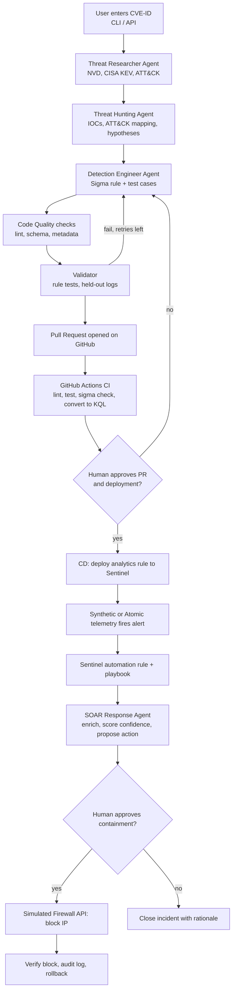

This diagram shows the finished core system. Section 9 builds it up one slice at a time, and Slice 9 adds parallel, supervisor and agent-to-agent extensions on top.

### Example run: `CVE-2021-44228` (Log4Shell)

1. Researcher pulls the NVD record, checks CISA KEV, and looks up ATT&CK techniques.
2. Hunting agent extracts IOCs (`${jndi:ldap://...}` patterns, callback domains/IPs) from sourced reports and maps them to ATT&CK (e.g. T1190, T1059, T1105).
3. Hypothesis: a Java process spawns a shell or makes an unexpected outbound LDAP/RMI connection.
4. Detection agent writes a Sigma rule (child process of `java` running `sh`/`bash`/`curl`/`wget`) plus positive and negative test logs.
5. PR is opened; CI lints, runs tests, validates the Sigma schema, and converts to KQL.
6. You review and merge, then approve the deployment; CD deploys it to Sentinel as a scheduled analytics rule.
7. Synthetic Java process events are ingested into `LinuxProcess_CL`; the alert fires.
8. An automation rule triggers the playbook; the SOAR agent proposes blocking the synthetic external IP; you approve; the simulated firewall blocks it; the agent verifies and records an audit entry.

### Example run 2: `CVE-2026-88771` (Citrix NetScaler ADC/Gateway)

Chosen from the advisory set `CVE-2026-88771` to `CVE-2026-88778` (Citrix bulletin CTX697096). Values below come from NVD as of 2026-10-17; the Researcher agent re-checks them on every run.

| Field | Value |
|---|---|
| Weakness | Improper input validation (CWE-20) |
| Impact | Unauthenticated remote command execution |
| CVSS v3.1 | 9.8 Critical (`AV:N/AC:L/PR:N/UI:N`) |
| CISA KEV | Yes, added 2026-09-27, due 2026-09-30 |
| SSVC | Exploitation: active, automatable: yes, technical impact: total |
| Affected | NetScaler ADC and Gateway before 14.1-73.37 and before 13.1-64.23 (plus FIPS/NDcPP builds) |

**Why this one**
- It is the only one in the set that is both actively exploited (KEV, SSVC "active") and unauthenticated command execution, so it has the clearest hunting hypothesis.
- `CVE-2026-88772` is also in KEV, but it is a memory-corruption bug (CWE-119) with high attack complexity. It is hard to detect from behaviour and a poor first rule.
- `CVE-2026-88773` (request smuggling) and `88774` to `88778` (overflow, policy bypass, predictable values) are not in KEV or have no exploitation evidence, and mostly cause DoS or information exposure.

**Pipeline walkthrough**
1. Researcher pulls the NVD record, confirms KEV status, and collects the vendor advisory and public reports.
2. Hunting agent extracts IOCs only from sourced reports (the NVD record itself lists none), and proposes ATT&CK mappings such as T1190 (exploit public-facing application) and T1059 (command execution) for review.
3. Hypotheses:
   - A NetScaler appliance receives an unusual request, then spawns a shell or an unexpected child process.
   - The appliance makes an unexpected outbound connection to an external IP after an inbound request.
4. Detection agent writes a Sigma rule with positive and negative synthetic logs.
5. CI, human approval, and Sentinel deployment follow the same path as example 1.
6. SOAR agent proposes blocking the synthetic source IP; you approve; the simulated firewall blocks it; the agent verifies and audits.

**Lab caveat:** a NetScaler appliance does not run Atomic Red Team or Azure Monitor Agent. Replay synthetic syslog/CEF events into a custom Sentinel table instead, and use a generic Linux web-server process-creation test for the Atomic exercise.

Compare both examples: Log4Shell has rich public IOCs and endpoint telemetry, while the Citrix case tests how the agents behave when IOCs are sparse and the data source is an appliance. In Slice 9 the Citrix case is also what the triage supervisor learns to route differently.

---

## 3. Agents

| Agent | Kind | Built in | Responsibility | Inputs | Outputs |
|---|---|---|---|---|---|
| Threat Researcher | LLM | Slice 2 | Gather CVE facts from NVD, CISA KEV and ATT&CK | CVE ID | Structured CVE intel (CVSS, KEV status, affected products, references) |
| Threat Hunting | LLM | Slice 3 (parallel in Slice 9) | Fetch threat reports, extract IOCs, map to MITRE ATT&CK, form hypotheses | CVE intel, reference URLs | IOC list with sources and confidence, ATT&CK techniques, hypotheses |
| Detection Engineer | LLM | Slice 4 | Write Sigma rules and test cases | Hypotheses, IOCs | `rules/*.yml`, `tests/rules/*.json` |
| Code Quality | Deterministic | Slice 4 | Check style, schema, secrets, rule metadata, unique rule IDs | Generated files | Pass/fail report with reasons |
| Validator | Deterministic | Slice 0b (graph node in Slice 4, Atomic in Slice 6) | Run rule against positive/negative and held-out logs; record Atomic results | Rule, test data | Test report, detection and false-positive rates |
| Evaluation | Deterministic (+ optional LLM judge) | Slice 2 | Score agent outputs (grounding, schema, hallucination) | Agent outputs, golden set | Eval metrics |
| CI/CD | Deterministic | Slices 0a, 0b, 1b, 5 | Run checks, open PR, deploy and undeploy rules | Validated rule | PR, KQL artifact, deployment record |
| SOAR Response | LLM | Slice 7 | Enrich incident, propose containment, execute after approval | Sentinel incident | Action proposal, execution result, audit entry, incident comment |
| Triage Supervisor | LLM | Slice 9 | Decide what kind of detection a CVE needs and route to the right specialist | CVE intel | Route: endpoint, appliance/network, or no behavioural rule |

"Deterministic" nodes are plain Python graph nodes or tools, not LLM calls. Use an LLM only where reasoning over unstructured text is needed.

Human-in-the-loop gates: PR review, deployment approval (protected GitHub Environment), and containment approval (SOAR).

---

## 4. Agent patterns used

The project introduces one orchestration pattern at a time, matching the concepts in [notes/01-agents-concepts.md](notes/01-agents-concepts.md).

| Pattern | Where | Slice |
|---|---|---|
| Single agent | Researcher: CVE ID in, structured intel out | 2 |
| Sequential | Researcher → Hunter → Detection Engineer → Quality → Validator | 3, 4 |
| Bounded loop | Validator errors go back to the Detection Engineer, with a retry limit | 4 |
| Human-in-the-loop | PR review, deployment approval, containment approval | 5, 7 |
| Parallel (fan-out / fan-in) | Hunter analyses each threat report in parallel; a merge node deduplicates IOCs. Batch runs over several CVEs | 9 |
| Supervisor / router | Triage agent routes a CVE to an endpoint or appliance detection specialist, or stops with "no behavioural rule" | 9 |
| Agent as API | SOAR agent runs as its own FastAPI service called by a Sentinel playbook | 7 |
| Agent-to-agent (A2A) | Detection pipeline and SOAR agent are separate services that exchange context over the A2A protocol | 9 |
| MCP | NVD, KEV, ATT&CK and Sigma tools exposed as an MCP server any agent client can use | 9 |

---

## 5. Target architecture

This is the end state of the core system. Section 9 builds it up slice by slice, each with its own smaller diagram.

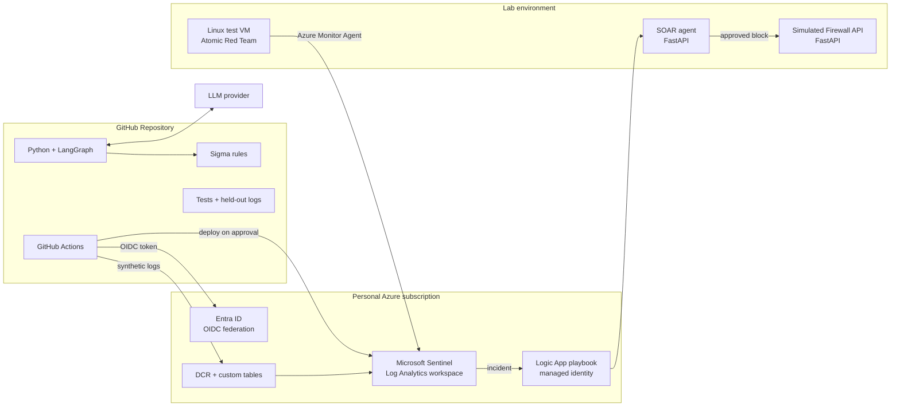

### Design principles

- Agents are LangGraph nodes with typed state (Pydantic models) and structured outputs.
- Every LLM output is schema-validated; no free text flows between agents.
- Deterministic tools (NVD client, Sigma converter, test runner, Sentinel client) are separate from LLM reasoning.
- Human approval is a graph interrupt or a protected environment, not a prompt convention.
- Every identity gets only the role it needs, scoped as narrowly as Azure allows. No stored secrets.
- All deployments and SOAR actions are idempotent, logged, and reversible.

---

## 6. Tech stack

| Layer | Choice | Why |
|---|---|---|
| Language | Python 3.11+ | Ecosystem for security and AI |
| Agent orchestration | LangGraph | Stateful graphs, parallel branches, human-in-the-loop interrupts |
| LLM | OpenAI / Azure OpenAI / Anthropic / Ollama (configurable) | Swap via env var; Ollama for free local runs |
| Config | pydantic-settings | Pinned model version, per-call and per-run token caps |
| Data models | Pydantic v2 | Validation of agent I/O |
| Intel sources | NVD API 2.0, CISA KEV JSON, MITRE ATT&CK (STIX), public reports | Free and authoritative |
| Detection format | Sigma | Vendor-neutral, large public rule set (SigmaHQ) |
| Rule conversion | pySigma + `pySigma-backend-kusto`, `sigma-cli` | Sigma to KQL |
| Rule testing | Sigma converted to SQLite (`pySigma-backend-sqlite`) or Zircolite, run against JSON logs | Fast local rule tests in CI |
| SIEM | Microsoft Sentinel (Log Analytics) | Target platform |
| Ingestion | Logs Ingestion API, DCR, custom `_CL` tables | Synthetic and appliance telemetry |
| Identity | Entra ID app registration with OIDC federated credentials, Azure RBAC, managed identities | No static credentials, least privilege |
| SOAR | Sentinel automation rules + Logic App playbook, FastAPI SOAR agent, FastAPI simulated firewall (Docker) | Real playbook flow, safe containment |
| Emulation | Atomic Red Team + Invoke-AtomicRedTeam | Realistic test telemetry |
| Multi-agent extensions | LangGraph `Send` (fan-out), A2A protocol (`a2a-sdk`), MCP Python SDK | Parallel, agent-to-agent, shared tools |
| Testing | pytest, pytest-cov, hypothesis | Unit and property tests |
| Quality | ruff, mypy, bandit, pre-commit | Lint, types, security |
| Eval | pytest-based golden sets, SigmaHQ rules tagged with CVEs, optional promptfoo / DeepEval | LLM output quality |
| CI/CD | GitHub Actions with protected Environments | Pipeline and approvals |
| IaC | Bicep | Workspace references, tables, DCR, analytics rules, playbooks |
| Containers | Docker, docker-compose | Reproducible lab |
| Observability | structlog, LangSmith or Phoenix (optional) | Tracing agent runs |

---

## 7. Repository layout

```
cve_to_rule/
├── README.md
├── pyproject.toml
├── .pre-commit-config.yaml
├── .env.example
├── docker-compose.yml
├── notes/                     # weekly lesson notes (01-agents-concepts.md, ...)
├── src/cve2rule/
│   ├── cli.py                 # entry point: cve2rule research CVE-2021-44228
│   ├── config.py              # model name, token caps, provider settings
│   ├── graph.py               # LangGraph workflow
│   ├── state.py               # Pydantic state models
│   ├── agents/
│   │   ├── researcher.py
│   │   ├── hunter.py
│   │   ├── detection_engineer.py
│   │   ├── code_quality.py
│   │   ├── validator.py
│   │   ├── evaluator.py
│   │   ├── soar.py
│   │   └── triage.py          # Slice 9 supervisor
│   ├── tools/
│   │   ├── nvd.py
│   │   ├── cisa_kev.py
│   │   ├── attack.py
│   │   ├── sigma_convert.py
│   │   ├── github_pr.py
│   │   └── sentinel.py
│   ├── services/
│   │   ├── soar_api.py        # SOAR agent as a FastAPI service (Slice 7)
│   │   ├── a2a/               # A2A agent cards and handlers (Slice 9)
│   │   └── mcp_server.py      # tools exposed over MCP (Slice 9)
│   └── prompts/
├── rules/                     # Sigma rules (hand-written first, later generated)
├── pipelines/                 # custom pySigma pipelines: Sigma fields -> table columns
├── deploy/                    # rule packaging and Sentinel sync scripts
├── tests/
│   ├── unit/
│   ├── rules/                 # rule tests with synthetic logs
│   │   └── holdout/           # human-written logs, never shown to generators
│   ├── evals/                 # LLM golden-set evals
│   └── data/
├── lab/
│   ├── firewall_api/          # simulated firewall
│   ├── atomic/                # Atomic Red Team runbooks
│   ├── playbooks/             # Logic App playbooks (Bicep)
│   └── infra/                 # Bicep: tables, DCR, role assignments, schemas
├── docs/
└── .github/workflows/
    ├── ci.yml                 # lint, test, rule validation, KQL build
    ├── eval.yml               # LLM evals (scheduled / manual)
    └── deploy.yml             # sync rules to Sentinel after approval
```

---

## 8. CI/CD pipeline

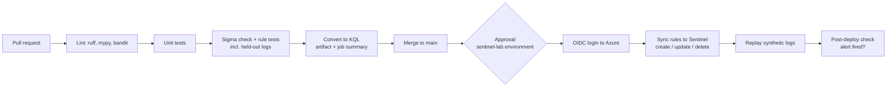

This is the final pipeline. Slices 0a, 0b and 1b build it; later slices add stages they need (integration tests for the firewall API in Slice 7).

- `ci.yml` runs on every PR and never touches Azure or a real LLM.
- `deploy.yml` runs on merge to `main` and uses the protected `sentinel-lab` GitHub Environment with you as required reviewer.
- Azure auth uses OIDC federated credentials, not stored secrets.
- LLM calls in CI are mocked; real-model evals run in `eval.yml` on schedule or manual dispatch.

---

## 9. Build plan: thin slice first

Build a thin version of the whole pipeline first, then deepen one stage per slice. Every slice ends with a working, committed pipeline, so you always have something that runs end to end.

The order puts detection-as-code on real Sentinel before any LLM agent. By the end of Slice 1b, a hand-written Sigma rule goes from Git to a live analytics rule. Every agent added after that just feeds more rules into a pipeline that already works.

Rules for every slice:
- Work on a branch, open a PR, and merge only when CI is green.
- Each step produces working code and teaches one concept (*Learn:*).
- A slice is finished only when its **Done when** check passes.
- Anything not built yet stays manual (you do it by hand) or is skipped. Don't build stubs for future slices.

```mermaid
flowchart LR
    S0A[0a<br/>Repo, CI, NVD client] --> S0B[0b<br/>Rule as code, KQL]
    S0B --> S1A[1a<br/>Azure + identity]
    S1A --> S1B[1b<br/>Sentinel CD]
    S1B --> S2[2<br/>Researcher + evals]
    S2 --> S3[3<br/>Hunting agent]
    S3 --> S4[4<br/>Detection agent + graph]
    S4 --> S5[5<br/>PR automation]
    S5 --> S6[6<br/>Atomic Red Team]
    S6 --> S7[7<br/>SOAR playbook]
    S7 --> S8[8<br/>Hardening]
    S8 --> S9[9<br/>Multi-agent extensions]
```

| Slice | Adds | Still manual or not yet built |
|---|---|---|
| 0a | Tooling, branch protection, CI (lint, types, tests), NVD client, CLI | Everything with an LLM or Azure |
| 0b | Table schema, custom pySigma pipeline, hand-written rule and held-out logs, rule tests, KQL artifact | Azure, agents |
| 1a | Bicep for tables and DCR on your existing workspace, budget alert, Entra app with OIDC, scoped role assignments | Rule deployment, agents |
| 1b | `deploy.yml`, rule packaging, create/update/delete sync, synthetic ingestion (endpoint and appliance), post-deploy check | Agents |
| 2 | Config with token caps, Researcher agent, KEV and ATT&CK tools, eval harness, `eval.yml` | Hunting, rule writing |
| 3 | Report fetcher, Hunting agent with sourced IOCs, two-node graph | Rule writing |
| 4 | Detection Engineer agent, quality checks, validator node, retry loop, full graph | PRs (you commit by hand) |
| 5 | Agent opens PRs into the Slice 1b pipeline | Real telemetry, SOAR |
| 6 | Atomic Red Team VM and telemetry, parser to the shared schema | SOAR |
| 7 | Simulated firewall, SOAR agent service, automation rule + playbook, approval, rollback | Nothing in the core |
| 8 | Guardrails, observability, security review, demo | Extensions |
| 9 | Parallel hunting, triage supervisor, A2A between pipeline and SOAR, MCP tool server | Nothing |

New components in each diagram below are drawn with a thick green border.

---

### Slice 0a: Repo, CI and first tool (no LLM, no Azure)

**Goal:** green CI and a CLI that prints a parsed NVD record.

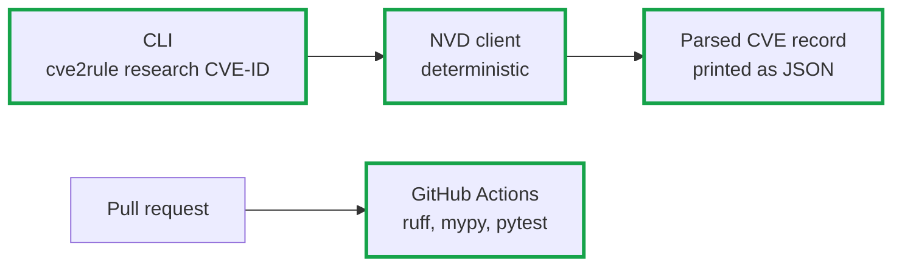

**Steps**
1. **Repo and tooling**: `pyproject.toml`, virtualenv, ruff, mypy, pytest, pre-commit, `.env.example`. *Learn: project structure, dependency management.*
2. **Branch protection**: protect `main`, require PRs and passing status checks. *Learn: SDLC, code review.*
3. **First CI**: `ci.yml` runs ruff, mypy and one trivial test on every PR, with pip caching. *Learn: GitHub Actions triggers, jobs, caching.*
4. **NVD client** (`tools/nvd.py`): fetch one CVE, parse it into a Pydantic model, handle rate limits and missing fields. Unit tests use recorded HTTP responses, never the live API. *Learn: API clients, test doubles.*
5. **CLI** (`cli.py`): `cve2rule research CVE-2021-44228` prints the parsed record as JSON. *Learn: entry points.*

**Done when:** `cve2rule research CVE-2021-44228` prints the parsed NVD record, and a PR gets green CI with ruff, mypy and pytest.

---

### Slice 0b: Rule as code (no LLM, no Azure)

**Goal:** `hand-written Sigma rule → PR → CI → tested KQL file`, on a real table schema.

The rule, the test logs, the KQL and (in Slice 1) the Sentinel table all have to agree on field names. This slice fixes the target table schema first and maps Sigma fields to it with one custom pipeline. The rule tests and the KQL conversion both use that pipeline, so CI tests the mapping and not only the rule logic.

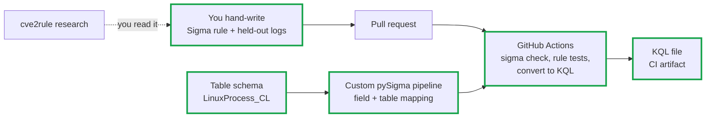

**Steps**
1. **Table schema** (`lab/infra/schemas/LinuxProcess_CL.json`): define the columns of the custom process-creation table, for example `TimeGenerated`, `Computer`, `User`, `ProcessName`, `CommandLine`, `ParentProcessName`, `ParentCommandLine`. This schema is the contract for test logs, the pipeline and the Sentinel table in Slice 1a. *Learn: data modelling for detections.*
2. **Custom pySigma pipeline** (`pipelines/linux_process.yml`): map Sigma's `process_creation` fields (`Image`, `CommandLine`, `ParentImage`, ...) to the table columns and set the KQL target table. The built-in Kusto pipelines target Windows/Defender tables, so a Linux rule on a custom table needs its own mapping. *Learn: pySigma processing pipelines.*
3. **Hand-write the Log4Shell rule** using the NVD output and public reports: `rules/log4shell_java_child_shell.yml` (a `java` parent spawning `sh`, `bash`, `curl` or `wget`), with a unique `id`, `status: experimental`, ATT&CK tags, `falsepositives` and `level`. Validate it with `sigma check`. *Learn: Sigma syntax, logsources, modifiers.*
4. **Held-out test logs** (`tests/rules/holdout/`): positive events (exploit-like child processes) and negative events (normal Tomcat/Jenkins/Elasticsearch child processes), written by you and using exactly the table schema columns. No generator ever sees this set (see Slice 4). *Learn: detection unit testing, false-positive thinking.*
5. **Rule tests**: a pytest that converts the rule to SQLite with the custom field mapping (or runs Zircolite with the same mapping), loads the JSON logs, and asserts that every positive event matches and no negative event does. Load the logs into a table that has every column the query names (missing ones as `NULL`), because SQLite fails to prepare a query that names an unknown column. Pin `pySigma`, `sigma-cli` and the backends to versions that work together; `sigma-cli` 3.1 needs pySigma 1.x while the newest SQLite backend needs pySigma 2.x. *Learn: testing detections without a SIEM, dependency pinning.*
6. **Extend CI**: add `sigma check`, the rule tests, and `sigma convert -t kusto -p pipelines/linux_process.yml`. Upload the `.kql` file as a build artifact and print it to the job summary. *Learn: pipeline stages, artifacts.*

**Done when:** a PR with the hand-written rule turns CI green and produces a `.kql` file that queries `LinuxProcess_CL` using its real column names.

---

### Slice 1a: Azure foundation and identity

**Goal:** your existing Sentinel workspace is described in code, has the custom tables the rules need, and GitHub can reach it with no stored secrets and only the permissions it needs.

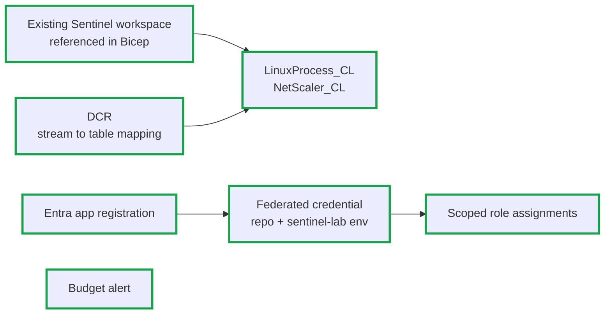

**Steps**
1. **Reference the workspace in Bicep** (`lab/infra/`): use `existing` resources for the workspace you already deployed, so IaC adds to it without recreating it. Run infra deployments yourself with `az deployment group create`; CI does not get permission to change infrastructure. *Learn: IaC against existing resources.*
2. **Budget alert and teardown**: a budget with an email alert on the resource group, and a script that removes everything this project adds. Set the workspace's daily ingestion cap. *Learn: cloud cost control.*
3. **Custom tables**: create `LinuxProcess_CL` from the Slice 0b schema file, and `NetScaler_CL` for the Citrix example. *Learn: Log Analytics custom tables.*
4. **DCR**: a data collection rule that maps an input stream to each table, using the Logs Ingestion API. *Learn: DCRs and ingestion-time transformation.*
5. **Entra app and OIDC**: an app registration with a federated credential whose subject is `repo:<owner>/cve_to_rule:environment:sentinel-lab`, so only jobs running in that GitHub Environment can get a token. *Learn: workload identity federation.*
6. **Least-privilege roles**, each scoped as narrowly as possible:

   | Identity | Role | Scope | Used for |
   |---|---|---|---|
   | GitHub deploy app | Microsoft Sentinel Contributor | Workspace | Create, update, delete analytics rules |
   | GitHub deploy app | Monitoring Metrics Publisher | DCR only | Send synthetic logs |
   | GitHub deploy app | Log Analytics Reader | Workspace | Post-deploy alert check |
   | You | Owner (or Contributor + User Access Administrator) | Resource group | Infra deployments, role assignments |

   *Learn: Azure RBAC, scope, separation of duties.*
7. **Protected environment**: create the `sentinel-lab` GitHub Environment with you as required reviewer, and store only non-secret IDs there (tenant, subscription, client ID, workspace, DCR endpoint). *Learn: deployment gates.*
8. **Smoke test**: a manual workflow in that environment that logs in with OIDC and lists analytics rules. It proves the identity works before any deployment code exists.

**Done when:** both custom tables exist, the budget alert is active, and the smoke-test workflow lists your analytics rules using OIDC with no secrets in the repo or in GitHub.

---

### Slice 1b: Detection-as-code to Sentinel

**Goal:** a merged Sigma rule becomes a live analytics rule, fires on synthetic data, and disappears from Sentinel when it is deleted from `rules/`.

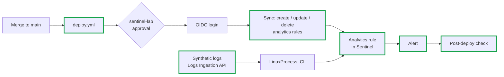

**Steps**
1. **Rule packaging** (`deploy/`): wrap the KQL as a scheduled analytics rule payload with severity, ATT&CK tactics and techniques, query frequency and lookback taken from the Sigma metadata. Derive the analytics rule's ID from the Sigma `id`, so redeploying updates the rule in place instead of creating a duplicate. *Learn: mapping detection metadata to the SIEM.*
2. **Sync** (`tools/sentinel.py`): compare `rules/` with the rules this project has deployed (marked with a tag or name prefix), then create, update or delete. Never touch rules the project didn't create. *Learn: declarative deployment, reconciliation.*
3. **Status lifecycle**: `experimental` rules deploy disabled; `test` and `stable` rules deploy enabled. Promote a rule by changing its `status` in a PR. *Learn: detection-as-code lifecycle.*
4. **`deploy.yml`**: on merge to `main`, rebuild the KQL, wait for approval in `sentinel-lab`, log in with OIDC, and sync. Add a `--dry-run` mode that prints the plan, and run it in PRs without Azure access. *Learn: CD, environments, plan/apply.*
5. **Synthetic ingestion (endpoint)**: a script that sends the held-out positive and negative logs through the Logs Ingestion API into `LinuxProcess_CL`. The logs already match the table, so this also tests the field mapping against the real table. Give test events a run ID so the check can find them.
6. **Synthetic ingestion (appliance)**: for the Citrix example, a matching pipeline in `pipelines/` for `NetScaler_CL`, and a replay of synthetic NetScaler events. *Learn: appliance telemetry when no endpoint agent is possible.*
7. **Post-deploy check**: poll `SecurityAlert` (with a timeout that allows for ingestion delay and the rule's schedule) and confirm the rule fired on the positive events and not on the negative ones. Fail the workflow otherwise. Test with the rule temporarily enabled if it is `experimental`. *Learn: verifying a deployment, not just running it.*

**Done when:** a merged rule appears in Sentinel, replayed positive logs produce an alert while negatives don't, deleting a rule from `rules/` removes it from Sentinel, and the Citrix replay reaches `NetScaler_CL`.

---

### Slice 2: Researcher agent, grounding and evals

**Goal:** the first LLM agent, trustworthy and measurable from day one.

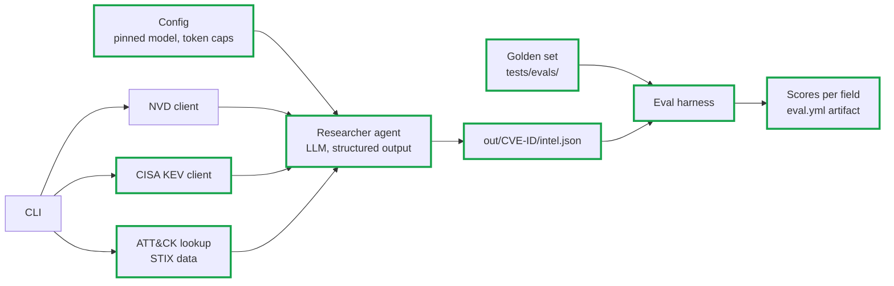

**Steps**
1. **Config** (`config.py`, pydantic-settings): LLM provider, a pinned model version (not a floating alias), a per-call token limit and a per-run token cap. A run that hits the cap stops with a clear error. *Learn: cost and reproducibility controls.*
2. **CISA KEV client** (`tools/cisa_kev.py`): download and cache the KEV JSON, look up a CVE, validate it with Pydantic. *Learn: data validation, caching.*
3. **ATT&CK lookup** (`tools/attack.py`): load the Enterprise ATT&CK STIX bundle, look up techniques by ID and name, and reject unknown IDs. *Learn: knowledge-base grounding.*
4. **Researcher agent** (`agents/researcher.py`): one LangGraph node that calls the tools and returns a `CveIntel` Pydantic model through structured output, including KEV fields (date added, due date, ransomware use). The agent reports what the tools return and never guesses these values. *Learn: prompts, structured outputs, tool calling.*
5. **CLI writes intel**: `cve2rule research CVE-2021-44228` now writes `out/CVE-2021-44228/intel.json` and logs token usage for the run. Unit tests use a fake LLM so CI never calls a real model. *Learn: dependency injection for testability.*
6. **Golden set**: 5 to 10 CVEs (including Log4Shell and the Citrix example) with expected CVSS, KEV status, CWE and affected products, checked by hand against NVD and CISA.
7. **Eval harness** (`tests/evals/`, pytest marker `eval`): run the Researcher on the golden set and score schema validity and per-field accuracy. The set is small, so treat accuracy as a trend between runs, not a pass/fail threshold. Schema validity is the only hard failure. *Learn: evaluating LLM output.*
8. **`eval.yml`**: runs on `workflow_dispatch` and on a weekly schedule with the pinned model, under the per-run token cap. It uploads scores, model name and token usage as an artifact so changes in quality or cost show up. `ci.yml` keeps using the fake LLM. *Learn: separating deterministic CI from nondeterministic evals.*

**Done when:** `cve2rule research CVE-2021-44228` writes a valid `intel.json` within the token cap, the eval run reports per-field accuracy and token usage for every golden CVE, and `ci.yml` still runs fully offline.

---

### Slice 3: Hunting agent

**Goal:** IOCs, ATT&CK techniques and hypotheses, each traceable to a source.

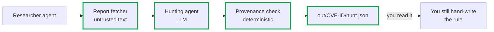

**Steps**
1. **Report fetcher**: fetch reference URLs from the NVD record, strip HTML, enforce size limits and an allow-list of domains, and mark the content as untrusted. *Learn: prompt-injection surfaces.*
2. **Hunting agent** (`agents/hunter.py`): output IOCs where each has `value`, `type`, `source_url`, `quote` and `confidence`; ATT&CK techniques with a rationale; and testable hypotheses. *Learn: grounding, hallucination control.*
3. **Provenance check**: deterministic code that confirms each `quote` exists in the fetched source and each IOC value appears in its quote. Drop or flag anything that fails. *Learn: verifying LLM output in code.*
4. **ATT&CK validation**: every technique ID must exist in the STIX data from Slice 2.
5. **Two-node graph**: Researcher → Hunter in LangGraph with typed state. This is the first sequential pipeline. *Learn: LangGraph state and edges.*
6. **Hunting evals**: add expected IOCs and techniques to the golden set, and track precision, recall and the unsupported-IOC rate.

**Done when:** `cve2rule hunt CVE-2021-44228` writes `hunt.json`, every IOC passes the provenance check, and the sparse Citrix case returns few IOCs instead of made-up ones.

---

### Slice 4: Detection Engineer agent and full graph

**Goal:** the system writes the rule and its tests. Your hand-written Slice 0b rule and held-out logs become the benchmark.

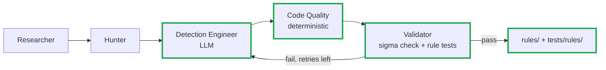

**Steps**
1. **Detection Engineer agent** (`agents/detection_engineer.py`): generate a Sigma rule and its positive and negative test logs from the hypotheses and IOCs, using the table schema so the logs have the right columns. *Learn: generation with structured output.*
2. **Code Quality checks** (`agents/code_quality.py`, deterministic): required fields (`id`, `title`, `status`, `level`, `logsource`, `falsepositives`, `attack.t*` tags), a rule `id` that is unique across `rules/`, new rules starting as `status: experimental`, no wildcard-only selectors, no single-field process-lineage rule without filters, no secrets.
3. **Validator** (`agents/validator.py`): reuses the Slice 0b rule-test code and custom pipeline and returns structured errors.
4. **Retry loop**: a conditional edge sends validator errors back to the Detection Engineer, with a maximum number of retries before stopping with a clear failure. *Learn: conditional edges, bounded loops.*
5. **Wire the full graph** in `graph.py` and add `cve2rule run CVE-ID`. *Learn: state machines.*
6. **Avoid circular testing**: the same LLM writes the rule and its test logs, so it can pass its own tests. Its own tests must still pass, but they don't count as evidence. Score every generated rule against the human-written logs in `tests/rules/holdout/`. Keep that folder out of the agent's prompts, tools and file access. *Learn: held-out evaluation.*
7. **Detection evals**: run the generated rule against the held-out logs, record detection and false-positive rates, and compare them with your Slice 0b rule. Add SigmaHQ rules tagged with a CVE (for example `cve.2021-44228`) as a larger reference set: compare the generated rule's logic and ATT&CK tags with the community rule.
8. **Prior-art check**: before generating, search SigmaHQ for rules already tagged with the CVE and include them in the PR as references, so you can choose to adopt one instead.

**Done when:** `cve2rule run CVE-2021-44228` writes a rule and tests locally, they pass the same CI checks as your Slice 0b rule, and the generated rule matches all held-out positives with no held-out negatives.

---

### Slice 5: PR automation

**Goal:** the agent opens the PR; you stay the reviewer; the Slice 1b pipeline deploys it.

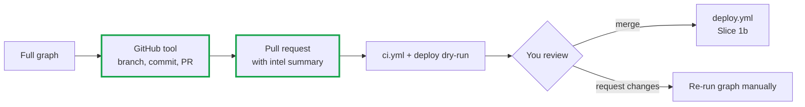

**Steps**
1. **Least-privilege identity**: a GitHub App (or fine-grained token) limited to this repo, with only contents and pull-request permissions, and unable to push to `main` or approve deployments. *Learn: least privilege for agents.*
2. **GitHub tool** (`tools/github_pr.py`): create a `rule/CVE-ID` branch, commit the rule and tests, and open a PR. *Learn: GitHub API.*
3. **PR body**: CVE summary, KEV status, IOCs with sources, ATT&CK techniques, hypotheses, local and held-out test results, and SigmaHQ prior art, so you can review without rerunning anything.
4. **CI job summary**: show the generated KQL, the rule-test results and the deploy dry-run plan in the PR checks.

**Done when:** `cve2rule run CVE-ID` ends by printing a PR URL, CI is green on that PR, you merge it, and after your approval the rule is live in Sentinel.

---

### Slice 6: Atomic Red Team telemetry

**Goal:** check rules against real telemetry, not only synthetic JSON.

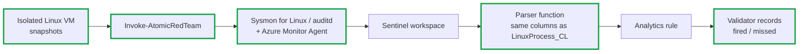

**Steps**
1. **Lab VM** on an isolated network with no production access and no real credentials. Take a clean snapshot. *Learn: safe lab design.*
2. **Telemetry**: install Sysmon for Linux or auditd plus the Azure Monitor Agent with a DCR for the VM, and confirm events arrive in the workspace.
3. **Parse real telemetry into the same shape**: Sysmon for Linux events usually land in the `Syslog` table with the event XML inside `SyslogMessage`, so they don't match `LinuxProcess_CL`. Use the ASIM Sysmon-for-Linux parser if it's available in your workspace, or write a KQL function that outputs the same columns as `LinuxProcess_CL`. Point the rule at a union of the table and the function so one rule covers synthetic and real data; deploy the function as code alongside the rules. *Learn: normalisation, parsers.*
4. **Install Invoke-AtomicRedTeam** (needs PowerShell 7 on Linux). Run `Invoke-AtomicTest T1059.004 -ShowDetails`, then `-CheckPrereqs`, then the test itself. *Learn: ATT&CK-mapped emulation.*
5. **Map atomics to rules**: each rule declares its expected atomic test in metadata, and the validator records whether the rule fired.
6. **Log4Shell gap**: there is no official atomic, so write a custom atomic that reproduces the behaviour (a Java process spawning a shell), or replay synthetic logs.
7. **Cleanup**: run `-Cleanup` and revert the snapshot after every session. Stop or deallocate the VM when idle to control cost.

**Done when:** at least one rule has a recorded atomic run with a fired or missed result, and the VM is back at its clean snapshot.

---

### Slice 7: SOAR playbook and agent

**Goal:** turn a Sentinel incident into an approved, verified and reversible containment action, using a real Sentinel playbook flow.

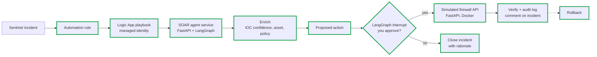

**Steps**
1. **Simulated firewall** (`lab/firewall_api/`): `POST /block`, `GET /status`, `DELETE /block/{ip}`, an audit log, and refusal of anything outside the documentation IP ranges. *Learn: designing a safe action target.*
2. **SOAR agent as a service** (`services/soar_api.py`): a FastAPI endpoint that accepts an incident ID, runs the SOAR graph, and pauses at the approval interrupt. Start with the CLI polling the Sentinel incidents API; add the playbook trigger in step 4. *Learn: agent as API.*
3. **SOAR agent** (`agents/soar.py`): read the incident and its entities, enrich them, and propose an action with confidence and rationale. *Learn: agent decision records.*
4. **Playbook as code** (`lab/playbooks/`, Bicep): an automation rule that runs a Logic App playbook on incidents from this project's rules. The playbook's managed identity has *Microsoft Sentinel Responder* on the workspace, and the playbook calls the SOAR service. Grant Sentinel permission to run playbooks in that resource group. Expose the SOAR service to the playbook in a way that doesn't open it to the internet without auth (for example a shared key in Key Vault, or a tunnel with access control). *Learn: Sentinel automation, managed identities.*
5. **Approval**: a LangGraph interrupt pauses until you approve or reject from the CLI (or a simple approval page). *Learn: human-in-the-loop as code.*
6. **Execute, verify, audit, roll back**: idempotent block, a status check afterwards, an audit entry, a comment on the Sentinel incident, and a tested rollback path. *Learn: safe agent actions.*
7. **Integration tests**: run the firewall container in CI and test approve, reject, duplicate-block and rollback with a fake Sentinel client.

**Done when:** a synthetic alert creates an incident, the playbook calls the SOAR agent, an approved block shows up in `/status`, the audit log and the incident comments, rollback removes it, and a rejected proposal closes the incident with a rationale.

---

### Slice 8: Hardening

**Goal:** make the core system safe to demo and maintain.

**Steps**
1. **Guardrails**: an allow-list of actions, protected IP ranges, rate limits, and prompt-injection tests that use poisoned report content.
2. **Observability**: structlog, optional LangSmith or Phoenix traces, and per-run cost and latency.
3. **Security review**: bandit, Dependabot, secret scanning, and a review of every GitHub and Azure permission against the Slice 1a table.
4. **Docs and demo**: architecture notes in `docs/` and a recorded Log4Shell end-to-end run.

**Done when:** the full Log4Shell run works from CLI to rollback, and the security checks are part of CI.

---

### Slice 9: Multi-agent extensions

**Goal:** add the more advanced orchestration patterns on top of a core that already works. Each part is independent; do them in any order. Every new agent and message channel gets the same guardrails as Slice 8.

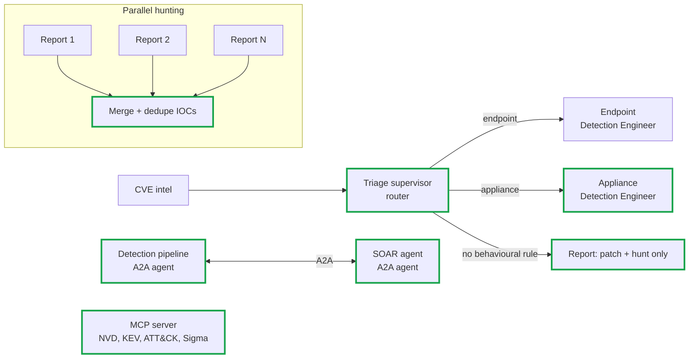

**9a. Parallel hunting (fan-out / fan-in)**
1. Use LangGraph's `Send` API to run one Hunter call per fetched report in parallel.
2. Merge results with a state reducer, deduplicate IOCs by normalised value, and keep every source for each IOC.
3. Add `cve2rule batch CVE-1 CVE-2 ...` that runs whole graphs for several CVEs concurrently under one shared token cap.
4. Compare cost, latency and IOC recall against the sequential Hunter on the golden set. *Learn: parallel branches, reducers, concurrency limits.*

**9b. Triage supervisor (router)**
1. A triage agent (`agents/triage.py`) reads the CVE intel and chooses a route: endpoint process rule, appliance/network rule, or no behavioural rule (for example memory corruption with no clear telemetry, like `CVE-2026-88772`).
2. Split the Detection Engineer into specialists with their own prompts, schemas and pipelines (`LinuxProcess_CL` vs `NetScaler_CL`).
3. The "no rule" route writes a short report with patch guidance and hunting queries instead of forcing a weak rule.
4. Add the expected route to the golden set and track routing accuracy. *Learn: supervisor/router pattern, specialist agents.*

**9c. Agent-to-agent (A2A) between detection and SOAR**
1. Run the detection pipeline and the SOAR agent as two separate services, each publishing an A2A agent card that describes its skills.
2. When a rule deploys, the detection agent sends the SOAR agent the rule's context (IOCs with sources, hypotheses, recommended response) so the SOAR agent has it when an incident arrives.
3. When the SOAR agent sees a false positive, it sends feedback back to the detection agent, which opens a PR that tunes the rule. You still review it.
4. Authenticate every call between agents, validate every message against a schema, and treat message content as untrusted input. *Learn: A2A protocol, service boundaries, trust between agents.*

**9d. MCP tool server**
1. Expose the NVD, KEV, ATT&CK and Sigma-convert tools through an MCP server (`services/mcp_server.py`).
2. Switch one agent to use the tools over MCP instead of direct imports, and check results are identical.
3. Use the same server from an MCP client such as Claude Code or VS Code for interactive hunting. *Learn: MCP, tools as a service.*

**Done when:** each part you build has its own eval or integration test, and the core Log4Shell run from Slice 8 still passes unchanged.

---

## 10. Atomic Red Team quick guide

- Atomics are small, ATT&CK-mapped tests (YAML) that generate real telemetry.
- Typical flow: `Invoke-AtomicTest <TechniqueID> -ShowDetails` → `-CheckPrereqs` → run → inspect logs in Sentinel → `-Cleanup`.
- Use a disposable VM with snapshots, no production network access, and no real credentials.
- Use results to answer: did the telemetry arrive, did the rule fire, what was missed?

---

## 11. Safety and security

- Lab only, in a personal Azure subscription used for nothing else. Never connect it to an employer tenant or use work data.
- Synthetic IPs from documentation ranges (`203.0.113.0/24`, `198.51.100.0/24`).
- SOAR never calls a real firewall; the API is simulated.
- Treat scraped threat report text and messages from other agents as untrusted input (prompt injection risk).
- No stored cloud secrets: OIDC for GitHub, managed identities in Azure, `.env` only for local LLM keys.
- Least-privilege roles at the narrowest scope; CI cannot change infrastructure or role assignments.
- Human approval required for PR merge, Sentinel deployment and containment.
- Budget alert and ingestion cap on the workspace from Slice 1a.

---

## 12. Getting started

```powershell
git clone <your-repo-url> ; cd cve_to_rule
python -m venv .venv ; .\.venv\Scripts\Activate.ps1
pip install -e ".[dev]"
copy .env.example .env      # add NVD API key; LLM key from Slice 2
pytest
cve2rule research CVE-2021-44228
```

(The `research` command prints the NVD record after Slice 0a and writes `intel.json` after Slice 2. Azure setup is in Slice 1a.)

---

## 13. Milestones

- [ ] M0a: CI green with lint, types and tests; NVD client and CLI (Slice 0a)
- [ ] M0b: Hand-written rule → CI → tested KQL artifact on the real table schema (Slice 0b)
- [ ] M1a: Custom tables, DCR, budget alert, OIDC identity with scoped roles (Slice 1a)
- [ ] M1b: Rule deployed to Sentinel with undeploy; alert fires on synthetic data (Slice 1b)
- [ ] M2: Researcher agent with KEV + ATT&CK grounding, eval harness and capped `eval.yml` (Slice 2)
- [ ] M3: Hunting agent with sourced IOCs (Slice 3)
- [ ] M4: Rules and tests generated automatically and scored on the held-out set (Slice 4)
- [ ] M5: Agent opens PRs; you review, merge and approve deployment (Slice 5)
- [ ] M6: Atomic Red Team telemetry validated (Slice 6)
- [ ] M7: Playbook-triggered SOAR block with approval, verification, rollback (Slice 7)
- [ ] M8: Hardened and documented (Slice 8)
- [ ] M9: Parallel hunting, triage supervisor, A2A, MCP (Slice 9, any order)

---

## 14. References

- NVD API: https://nvd.nist.gov/developers
- CISA KEV: https://www.cisa.gov/known-exploited-vulnerabilities-catalog
- MITRE ATT&CK: https://attack.mitre.org
- Sigma / pySigma / SigmaHQ rules: https://github.com/SigmaHQ
- Atomic Red Team: https://github.com/redcanaryco/atomic-red-team
- LangGraph: https://langchain-ai.github.io/langgraph/
- Microsoft Sentinel: https://learn.microsoft.com/azure/sentinel/
- Logs Ingestion API: https://learn.microsoft.com/azure/azure-monitor/logs/logs-ingestion-api-overview
- GitHub OIDC with Azure: https://docs.github.com/actions/deployment/security-hardening-your-deployments/configuring-openid-connect-in-azure
- A2A protocol: https://a2a-protocol.org
- Model Context Protocol: https://modelcontextprotocol.io
